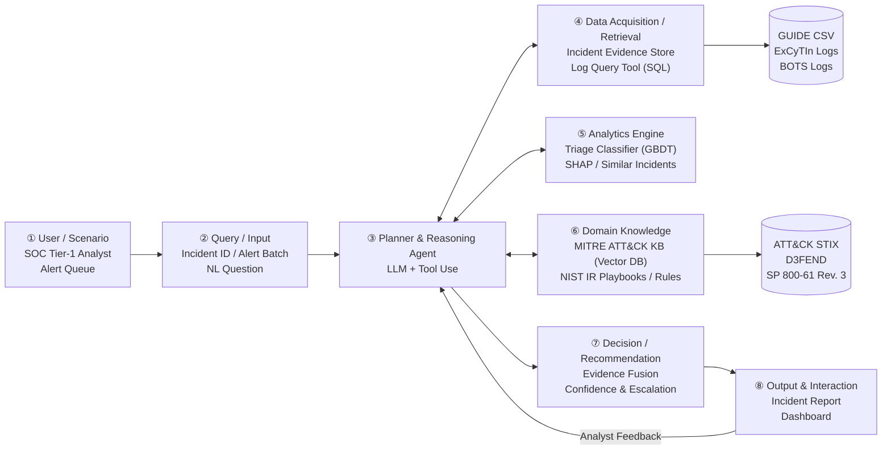
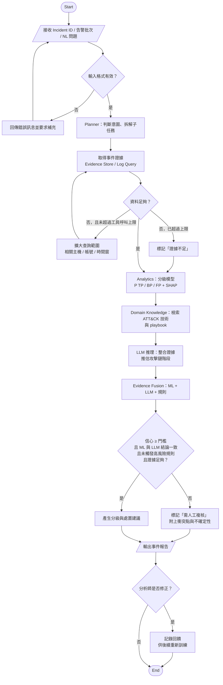

# DESIGN.md — AI SOC Analyst Agent

> 狀態：**Proposal 階段**（v0.8）。本文件從 Proposal 開始建立並隨開發持續更新。
> 文中的文獻編號（例如 [3]）對應 [`docs/proposal.md`](docs/proposal.md) §6 References。
> 標示「（規劃）」的項目尚未實作；標示「（待確認）」的項目需在下載資料或實作後驗證。

## 目錄

1. [Problem](#1-problem)
2. [Requirements](#2-requirements)
3. [System Architecture](#3-system-architecture)
4. [Components](#4-components)
5. [Data](#5-data)
6. [AI / Analytics](#6-ai--analytics)
7. [Domain Knowledge](#7-domain-knowledge)
8. [Flowchart](#8-flowchart)
9. [Algorithm (Pseudocode)](#9-algorithm-pseudocode)
10. [Evaluation Plan](#10-evaluation-plan)
11. [Implementation Mapping](#11-implementation-mapping)
12. [How to Run](#12-how-to-run)
13. [Results](#13-results)
14. [Limitations & Risks](#14-limitations--risks)
15. [Changelog](#15-changelog)

---

## 1. Problem

企業資安維運中心（Security Operations Center, SOC）每天收到大量告警，其中多數為誤報（False Positive）或無害的良性陽性（Benign Positive）。Tier-1 分析師必須逐一判讀告警、查詢相關 log、對照攻擊手法，才能決定是否升級處理，造成：

- **告警疲勞（Alert Fatigue）**：真正的攻擊被淹沒在大量誤報中。
- **判讀不一致**：不同分析師對同一類告警的處置標準不同。
- **知識門檻高**：將零散告警對應到 MITRE ATT&CK 攻擊鏈需要經驗。

**核心問題**：能否設計一個結合 ML 分級、資安領域知識（MITRE ATT&CK、事件應變流程）與 LLM 推理的 AI Agent，對告警／事件提供「**有依據、可解釋、知道何時該交給人**」的分級與處置建議？

## 2. Requirements

### 2.1 Functional Requirements

| ID | 需求 |
|---|---|
| FR1 | 輸入一個事件（Incident ID）或一批告警，輸出分級結果：TP / BP / FP |
| FR2 | 對每個分級提供信心分數與支持證據（關鍵特徵、相似歷史事件、對應 ATT&CK 技術） |
| FR3 | 將事件對應到 MITRE ATT&CK Tactic / Technique，並推估攻擊鏈階段 |
| FR4 | 依事件應變指引（NIST SP 800-61 Rev. 3）產生處置建議 |
| FR5 | 信心不足、結論衝突、高風險或證據不足時，標記為「需人工複核」（Human-in-the-loop） |
| FR6 | 支援自然語言調查問題（例如：「這台主機在告警前後還有哪些可疑行為？」） |
| FR7 | 產出結構化事件報告（JSON + Markdown） |

### 2.2 Non-Functional Requirements

| ID | 需求 |
|---|---|
| NFR1 | **可解釋性**：每個結論都必須能追溯到資料或知識來源 |
| NFR2 | **安全偏好**：寧可多升級，不可漏判真實攻擊（TP 漏判率為首要指標） |
| NFR3 | **可重現**：資料前處理、模型訓練、評估皆以腳本執行並固定 random seed |
| NFR4 | **成本可控**：記錄每個事件的 LLM token 用量與延遲 |

---

## 3. System Architecture



> Proposal 簡報第 11 頁的架構圖依此 Mermaid 繪製。

## 4. Components

### ① User / Application Scenario
- **使用者**：SOC Tier-1 / Tier-2 分析師。
- **情境**：分析師從告警佇列中選取事件，請 Agent 進行初步分級與調查，再由分析師決定最終處置。

### ② Query / Input
- **結構化輸入**：Incident ID、告警批次（來自 GUIDE 或 log 環境）。
- **自然語言輸入**：調查問題（FR6）。
- 輸入經 schema 驗證後轉為統一的 `TriageRequest` 物件。

### ③ Planner & Reasoning Agent
- 以 LLM 搭配 tool use，採 ReAct 式「思考 → 呼叫工具 → 觀察」迴圈。
- 負責：意圖判斷、子任務拆解、選擇工具、整合各模組結果、決定是否需要更多證據。
- 設定**最大工具呼叫次數**與 token 預算，避免無限迴圈（NFR4）。
- **Planner 的決策點**：每個事件的執行路徑會依證據而不同，不是固定流程。

| 決策點 | 依據 | 不同的路徑 |
|---|---|---|
| 選擇資料來源 | 輸入型態 | Incident ID → Evidence Store（GUIDE）；自然語言問題 → Log Query Tool（ExCyTIn，自行產生並執行 SQL） |
| 擴大查詢的方向 | `IsSufficient(E)` 哪一項未滿足 | 缺帳號上下文 → 查該帳號的登入紀錄；缺主機上下文 → 查程序與網路紀錄；查詢為空 → 先確認 log 是否中斷 |
| 擴大查詢的範圍 | 已對應到的攻擊鏈階段 | 出現 Lateral Movement 等技術時，把相關主機納入下一輪查詢 |
| 何時停止 | `IsSufficient(E)` 或用完預算 B | 證據足夠就進入分析；用完預算仍不足就標記「證據不足」並升級 |

- 在 GUIDE 上，欄位已匿名化，Planner 的選擇主要是「查哪些實體、擴大到哪裡」；在 ExCyTIn 上，Planner 要自行撰寫 SQL、多步追蹤證據，這是 E3 評估的重點。

### ④ Data Acquisition / Retrieval
- **Incident Evidence Store**：將 GUIDE 的 alert / evidence 以 DuckDB 聚合成事件層級的資料。
- **Log Query Tool**：在 ExCyTIn-Bench 的 SQL log 環境中執行查詢（僅允許唯讀 `SELECT`）。
- 工具輸出一律附上來源（資料表、欄位、列 ID），以滿足 NFR1。

### ⑤ Analytics Engine
- **Triage Classifier**：以 Gradient Boosted Trees（LightGBM / XGBoost）預測 P(TP)、P(BP)、P(FP)。
- **特徵**：告警數、Detector 歷史誤報率、實體類型分布、ATT&CK 技術數量與 Tactic 覆蓋、時間特徵等。
- **可解釋性**：SHAP 值列出影響最大的特徵。
- **相似事件檢索**：以特徵向量找出 k 個歷史相似事件及其標籤。

### ⑥ Domain Knowledge Integration
- **MITRE ATT&CK KB**：將 ATT&CK STIX 資料（Technique 描述、偵測方式、緩解措施）切塊後存入 Vector DB（Chroma），供 RAG 檢索。
- **事件應變流程**：NIST SP 800-61 Rev. 3（事件應變）與 MITRE D3FEND（防禦技術）整理為處置 playbook。
- **高風險攻擊鏈規則**（`Rules(T)`，觸發時標記 `high_risk`，見 Algorithm 2 第 06–08 行）：依據事件中出現的 ATT&CK 戰術與技術判斷，攻擊鏈越後段風險越高 [10][11]：

| 規則 | 條件（同一事件內） | 理由 |
|---|---|---|
| R1 攻擊鏈後段 | 出現 Exfiltration 或 Impact 戰術，或 GUIDE 的 `Category` 為 Ransomware | 資料可能已外洩或系統已受損 |
| R2 憑證加橫向移動 | 同時出現 Credential Access 與 Lateral Movement | 攻擊者已取得憑證並在內網擴散 |
| R3 入侵後站穩 | Initial Access 與 Execution、Persistence、Privilege Escalation 任一同時出現 | 攻擊已從入口推進到控制主機（GUIDE 的時間戳記有雜訊，因此不要求先後順序） |
| R4 清除痕跡 | 出現 T1070（Indicator Removal，例如清除 log） | 刪除紀錄本身就是攻擊訊號，也會讓「查無紀錄」不可信（M1） |
| R5 多階段攻擊 | 涵蓋 4 個以上不同的戰術 | 單一誤報很少同時觸發多個攻擊階段 |

規則只負責「標記高風險、偏向升級」，不單獨決定分級；R5 的門檻在驗證集上確認。

### ⑦ Decision / Recommendation
- **Evidence Fusion**：整合 ML 機率、LLM 推理、規則判斷，產生最終分級。
- **不確定性處理**：ML 與 LLM 結論衝突、信心低於門檻、觸發高風險規則，或用完工具呼叫上限仍證據不足時 → 標記「需人工複核」。
- **處置建議**：依分級與 ATT&CK 階段，從 playbook 產生建議動作（隔離主機、重設帳號、封鎖 IOC 等）。

### ⑧ Output & Interaction
- **事件報告**：分級、信心、證據鏈、ATT&CK 對應、建議動作、不確定性說明。
- **Dashboard**（規劃）：Streamlit 介面，顯示事件佇列、報告與 SHAP 圖。
- **Feedback**：分析師的修正會（1）立即加入相似事件檢索的歷史庫，之後遇到類似事件時可參考修正後的標籤；（2）累積一定數量後，用於重新調整門檻 τ 與重新訓練分級模型。

---

## 5. Data

| 資料集 | 年份 | 用途 | 授權 | 狀態 |
|---|---|---|---|---|
| Microsoft GUIDE（Kaggle: *Microsoft Security Incident Prediction*） | 2024 | 主資料集：分級模型訓練與評估（E1、E2、E4、Ablation）；`GUIDE_Test_Queue_Rankings.csv` 可做優先排序延伸實驗 | CDLA-2.0 | 已下載至 `data/archive/` |
| ExCyTIn-Bench（[microsoft/SecRL](https://github.com/microsoft/SecRL)） | 2025 | Agent 調查推理能力評估（E3、E5） | 程式為 MIT | 待下載（需 Docker + MySQL，約 10 GB） |
| CyberSOCEval | 2025 | LLM 威脅情資推理能力參考評估（選用） | 依官方 repo | 待評估 |
| Splunk BOTS v3 | 2020 | Demo 用真實格式 log 情境（選用） | CC0 | 待評估 |
| MITRE ATT&CK（STIX 2.1） | 實作時鎖定版本 | 領域知識庫 | MITRE ToU | 待下載 |

**GUIDE 規模**（根據原始論文）：約 1,300 萬筆 evidence、160 萬筆告警、100 萬起事件，涵蓋 6.1k 個組織、441 種 ATT&CK 技術；train / test = 70% / 30%。

**GUIDE_Train.csv 實際檢查結果**（2026-11-02，`experiments/e0_profile_guide.py`，完整輸出見 `experiments/results/guide_train_profile.json`）：

| 項目 | 結果 |
|---|---|
| 檔案大小 | Train 2.4 GB、Test 1.1 GB |
| 列數 | 9,516,837 列（每列是一筆告警中的一個證據實體） |
| 事件數 | 707,108 起（以 `OrgId` + `IncidentId` 為鍵；`IncidentId` 只在組織內唯一） |
| 組織數 | 5,769 |
| 事件層級標籤分布 | BP 346,598（49.0%）、FP 214,924（30.4%）、**TP 145,586（20.6%）** |
| 缺少標籤的列 | 51,340（0.54%） |
| 時間範圍 | 2023-11-20 至 2024-06-17（論文說明時間戳記已加入雜訊） |

**欄位可讀性**（決定 LLM 能讀懂什麼）：

| 類型 | 欄位 |
|---|---|
| **可讀文字** | `Category`（20 類，如 InitialAccess、Exfiltration）、`MitreTechniques`（如 T1078;T1078.004，432 種技術）、`EntityType`（33 種）、`EvidenceRole`、`ThreatFamily`、`ResourceType`、`Roles`、`AntispamDirection`、`SuspicionLevel`、`LastVerdict`、`ActionGranular` |
| **匿名化數字 ID** | `AlertTitle`（86,149 種）、`DetectorId`、所有實體欄位（IP、帳號、裝置、檔名、URL、Registry 等）、`OSFamily`、`OSVersion`、`CountryCode`、`State`、`City` |

**其他重要發現**：
- `MitreTechniques` 只在 42.5% 的列有值，E2 只能評估有標註的告警。
- `ActionGrouped` / `ActionGranular`（處置標籤）有 99.4% 缺值，**無法用 GUIDE 量化評估處置建議**，改以 E4 報告品質評分評估。
- 實體欄位沒有空值，「沒有該實體」似乎以固定 ID 表示（例如 `IpAddress` 最常見的值 360606），前處理時需要辨識並轉為缺值。（待確認）
- 事件的標籤以最後讀到的列為準，尚未檢查同一事件內各列標籤是否一致。（待確認）

**資料前處理**（規劃）：
1. Evidence → Alert → Incident 三層聚合。
2. 以事件（`OrgId` + `IncidentId`）為單位切分，避免同一事件的告警同時出現在訓練集和驗證集（data leakage）；另做以組織（OrgId）或時間切分的評估，檢驗對新客戶、新時段的泛化能力。
3. 分類別不平衡處理：class weight，必要時對 TP 加權。

下載與放置方式見 [`data/README.md`](data/README.md)。

## 6. AI / Analytics

| 元件 | 方法 | 角色 |
|---|---|---|
| 分級模型 | LightGBM / XGBoost | 對大量結構化特徵做快速、穩定的機率預測 |
| 解釋 | SHAP | 將模型判斷轉成分析師可讀的證據 |
| 知識檢索 | Embedding + Vector DB（Chroma） | RAG：取回相關 ATT&CK 技術與 playbook |
| 推理與報告 | LLM（tool use） | 整合證據、處理衝突、產生報告 |
| 決策融合 | 規則 + 加權機率 + 門檻 | 最終分級與是否升級 |

**設計理由**：實際檢查確認 GUIDE 的告警標題與所有實體欄位都是匿名化數字 ID（見 §5），LLM 無法從中讀出語意，因此分級的主力是 ML 模型。不過 `Category`、`MitreTechniques`、`EntityType` 等欄位是可讀文字，足以讓 LLM 結合 ATT&CK 知識推理攻擊鏈。LLM 的價值在於「整合 ML 結果與 ATT&CK 知識、處理衝突、產生可解釋報告」，以及在有原始 log 的環境（ExCyTIn）中進行調查。

## 7. Domain Knowledge

| 知識來源 | 內容 | 在系統中的用途 |
|---|---|---|
| MITRE ATT&CK | 14 個 Tactic、Technique / Sub-technique、偵測與緩解 | 告警對應、攻擊鏈推估、RAG 知識 |
| Cyber Kill Chain | 攻擊階段模型 | 判斷事件處於攻擊鏈哪一段，越後段風險越高 |
| NIST SP 800-61 Rev. 3 | 事件應變建議，以 CSF 2.0 六大功能（Govern、Identify、Protect、Detect、Respond、Recover）組織 | 處置建議的流程依據 |
| MITRE D3FEND | 防禦技術對應 | 由 ATT&CK 技術推導對應的防禦動作 |
| SOC 分級實務 | TP / BP / FP 定義（BP 與 FP 的區分見 [24]）、升級準則 | 輸出分類定義與人工複核的升級規則 |

### 7.1 設計原則（來自 Deep Research）

| 領域思維模式 | 對應的設計決策 | 實作位置 |
|---|---|---|
| M1 Assume Breach | 「查無紀錄」不可直接結案；擴大查詢，預算用完仍不確定就升級 | Flowchart「資料足夠？」迴圈；Algorithm 1 第 05–09、18 行 |
| M2 事件與攻擊鏈脈絡 | 以事件為分析單位；攻擊鏈階段作為特徵與高風險規則 | ④ Evidence Store；⑥ 領域規則 |
| M3 錯誤成本不對稱 | TP 漏判率為首要指標；高風險時偏向升級；同時報告升級率 | Algorithm 2 第 06–08 行；§10 E1 |
| M4 看 TTPs 而非 IOCs | 以 ATT&CK 技術為知識單位；避免模型過度依賴 IP、hash | ⑥ ATT&CK KB；⑤ 特徵選擇 |
| M5 自動化要可驗證 | 每個結論附證據鏈；衝突時明確標示；「需人工複核」狀態 | ⑦ Decision；⑧ 報告格式 |

詳細的領域研究（5 個核心思維模式、3 個專業爭論、10 個深度理解問題）見 [`docs/proposal.md`](docs/proposal.md) 第 4 節。

---

## 8. Flowchart



## 9. Algorithm (Pseudocode)

### Algorithm 1: SOC Triage Agent

```text
Algorithm 1: SOC Triage Agent
Input : Incident request Q (incident ID, alert batch, or NL question)
        Triage model M, ATT&CK knowledge base KB, playbook set PB
        Confidence threshold τ, tool-call budget B
Output: Triage report R

01: req ← ValidateAndParse(Q)
02: if req is invalid then return ErrorReport("missing or malformed input")
03: plan ← Planner.Decompose(req)                 ▷ subtasks: gather, classify, map, recommend
04: E ← ∅ ; calls ← 0
05: repeat                                         ▷ evidence gathering loop
06:     tool ← Planner.SelectTool(plan, E)
07:     E ← E ∪ tool.Execute(req, E)               ▷ every item carries its source reference
08:     calls ← calls + 1
09: until Planner.IsSufficient(E) or calls ≥ B
10: x ← ExtractFeatures(E)
11: p ← M.PredictProba(x)                          ▷ p = (p_TP, p_BP, p_FP)
12: φ ← SHAP(M, x)                                 ▷ top contributing features
13: S ← RetrieveSimilarIncidents(x, k)
14: T ← MapToATTACK(E, KB)                         ▷ techniques, tactics, kill-chain stage
15: K ← KB.Retrieve(T) ∪ PB.Retrieve(T)            ▷ RAG context
16: llm ← LLM.Reason(E, p, φ, S, T, K)             ▷ returns label, rationale, confidence
17: (label, conf, flags) ← FuseEvidence(p, llm, Rules(T))      ▷ Algorithm 2
18: if conf < τ or "conflict" ∈ flags or "high_risk" ∈ flags or not Planner.IsSufficient(E) then
19:     R.status ← "NEEDS_HUMAN_REVIEW"
20: else
21:     R.status ← "AUTO_TRIAGED"
22: R.actions ← PB.Recommend(label, T)
23: R ← R ∪ {label, conf, evidence: E, shap: φ, similar: S, attack: T, rationale: llm.rationale, flags}
24: return R
```

### Algorithm 2: Evidence Fusion

```text
Algorithm 2: FuseEvidence
Input : ML probabilities p, LLM output llm, rule results U
        Weights w_ml, w_llm (w_ml + w_llm = 1)
Output: label, confidence conf, flag set flags

01: flags ← ∅
02: q ← OneHotWithConfidence(llm.label, llm.confidence)
03: s ← w_ml · p + w_llm · q                      ▷ weighted class scores
04: label ← argmax(s) ; conf ← max(s)
05: if argmax(p) ≠ llm.label then flags ← flags ∪ {"conflict"}
06: if U contains a high-risk pattern then        ▷ e.g. late kill-chain stage
07:     flags ← flags ∪ {"high_risk"}
08:     if label ≠ TP and p_TP ≥ τ_safety then label ← TP    ▷ NFR2: prefer escalation
09: return (label, conf, flags)
```

**`IsSufficient(E)` 的判斷方式**：採規則判斷，不交給 LLM 自行決定，以避免 [3] 發現的過早結案；[25] 也觀察到，最後需要升級的告警，分析師會蒐集更多種類的資訊。三項都成立才算證據足夠：

1. 事件中每一筆告警都已取得對應的證據（evidence）。
2. 事件涉及的主要實體（帳號、主機）都至少有一筆上下文紀錄，例如登入、程序或網路活動。
3. 任一查詢回傳空結果時，必須確認同一資料來源在該時間窗內仍有其他紀錄，也就是 log 沒有中斷；無法確認時視為證據不足，而不是「沒有可疑活動」。

自然語言調查問題沒有告警清單，第 1 項改為「問題涉及的每個實體都已查詢過」。GUIDE 沒有原始 log，因此在 GUIDE 上第 3 項改為：檢查每筆告警的證據列是否齊全，並把代表「無此實體」的固定 ID 視為缺值，而不是一個真的實體（見 DESIGN.md §5 的待確認項目）。

**`OneHotWithConfidence` 的轉換方式**：LLM 自行回報的數值信心通常不可靠，因此只要求 LLM 回報「低／中／高」三級信心，分別對應 c = 0.5、0.7、0.9（實際數值在驗證集上調整）。LLM 判斷的類別得到 c，其餘兩類平分 1 − c。例如 LLM 判斷為 TP、信心「中」，則 q = (0.7, 0.15, 0.15)。

> 權重 `w_ml`、`w_llm` 與門檻 `τ`、`τ_safety` 將在驗證集上調整，不使用測試集調參。

---

## 10. Evaluation Plan

| 實驗 | 目的 | 資料 | Baselines | Metrics |
|---|---|---|---|---|
| E1 分級準確度 | Agent 分級是否優於單一方法 | GUIDE（依事件切分；另做依組織、時間切分） | ① 多數類別 ② Detector 歷史誤報率規則 ③ GBDT only ④ LLM only（無 KB） | Macro-F1、各類 Precision / Recall、**TP 漏判率**、**人工升級率**（兩者的取捨參考 [3] AIDA） |
| E2 ATT&CK 對應 | 知識整合是否正確 | GUIDE 中有 `MitreTechniques` 標註的告警（約 42.5% 的列） | LLM only vs. LLM + RAG | Technique / Tactic 層級 Precision、Recall |
| E3 調查推理 | Agent 是否能查 log 回答調查問題 | ExCyTIn-Bench | 論文公布的模型分數、無規劃的單輪 LLM | Benchmark reward / accuracy |
| E4 報告品質 | 報告是否有用、可信 | 抽樣 50 個事件 | 無 RAG 的報告 | 評分表（正確性、證據完整性、可執行性）：人工 + LLM-as-judge |
| E5 成本 | 實務可行性 | E1 / E3 | — | 每事件 token 數、延遲、工具呼叫次數 |
| Ablation | 各模組貢獻 | GUIDE | 分別移除 ⑤、⑥ 或升級規則 | 同 E1 |

## 11. Implementation Mapping

（規劃）目錄與模組對應：

| 架構模組 | 程式位置 |
|---|---|
| ② Input | `src/soc_agent/schemas.py` |
| ③ Planner | `src/soc_agent/agent/planner.py` |
| ④ Retrieval | `src/soc_agent/data/evidence_store.py`、`src/soc_agent/tools/log_query.py` |
| ⑤ Analytics | `src/soc_agent/analytics/triage_model.py`、`explain.py` |
| ⑥ Knowledge | `src/soc_agent/knowledge/attack_kb.py`、`playbooks/` |
| ⑦ Decision | `src/soc_agent/decision/fusion.py` |
| ⑧ Output | `src/soc_agent/report.py`、`app/dashboard.py` |
| 資料檢查（已完成） | `experiments/e0_profile_guide.py` |
| 實驗 | `experiments/e1_triage.py` … `e5_cost.py` |

## 12. How to Run

Agent 本體尚未實作，實作後更新本節。目前可執行的是 GUIDE 資料檢查：

```bash
python experiments/e0_profile_guide.py data/archive/GUIDE_Train.csv > experiments/results/guide_train_profile.json
```

## 13. Results

尚未進行實驗。Proposal 階段只列出預期結果（見 `docs/proposal.md`），不提供實驗數據。

## 14. Limitations & Risks

| 風險 | 影響 | 對策 |
|---|---|---|
| GUIDE 告警標題與實體欄位為匿名化 ID（已確認） | LLM 難以從語意理解告警 | 分級以 ML 為主；LLM 負責知識整合與報告；原始 log 推理改用 ExCyTIn |
| GUIDE 依論文只涵蓋兩週、來自單一廠商生態系 | 泛化能力有限 | 在 Limitations 中說明；以 ExCyTIn / BOTS 做跨資料集展示 |
| 類別不平衡 | TP 召回率偏低 | class weight、以 TP 漏判率為首要指標 |
| LLM 幻覺 | 錯誤的 ATT&CK 對應或建議 | RAG、要求引用來源、與 ML 結果交叉檢查、衝突時交給人工 |
| LLM 成本與延遲 | 無法處理大量告警；實驗花費上限約 550 美元（以 [3] 每告警 0.109 美元、5 次 × 1,000 事件估算） | 工具呼叫上限 B 與 token 預算；先用 200 個事件的小樣本開發；若 E5 顯示成本過高，改為只對 ML 不確定的事件呼叫 LLM（可選優化） |
| 開發時程只有 6 週 | 實驗可能無法全部完成 | 依優先順序執行：E1 → E2 → E5 → E3 → E4；第 5 週 ExCyTIn 仍無法運作就改用 BOTS v3 |

## 15. Changelog

| 版本 | 日期 | 內容 |
|---|---|---|
| v0.1 | 2026-11-02 | Proposal 階段初版：Problem、Requirements、Architecture、Flowchart、Pseudocode、Evaluation Plan |
| v0.2 | 2026-11-02 | 加入 GUIDE_Train.csv 實際檢查結果：確認匿名化欄位、標籤分布、`MitreTechniques` 覆蓋率、處置標籤缺值 |
| v0.3 | 2026-11-03 | 證據不足（用完工具呼叫上限）改為標記後繼續分析，並列入升級條件（Flowchart、Algorithm 1 第 18 行）；LLM 成本對策改為工具與 token 預算，「只對不確定事件呼叫 LLM」列為可選優化 |
| v0.4 | 2026-11-03 | 定義 `IsSufficient(E)` 與 `OneHotWithConfidence`；補充 Planner 決策點、回饋的用途、LLM 成本估算與時程風險 |
| v0.5 | 2026-11-03 | 新增 SOC 實務文獻 [24]–[26]，`IsSufficient` 的設計依據加入 [25] |
| v0.6 | 2026-11-03 | 補上 ExCyTIn-Bench 官方 repo 與授權；資料切分改以 `OrgId` + `IncidentId` 為鍵；How to Run 加入資料檢查指令 |
| v0.7 | 2026-11-03 | 列出高風險攻擊鏈規則 R1–R5；說明 `IsSufficient` 第 3 項在 GUIDE 上的檢查方式 |
| v0.8 | 2026-11-03 | R3 改為不要求先後順序（GUIDE 時間戳記有雜訊） |
