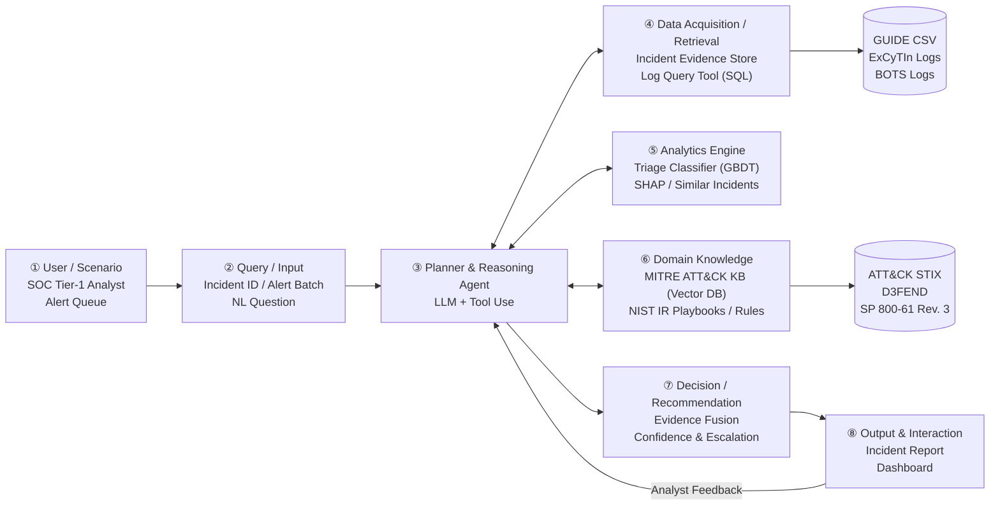
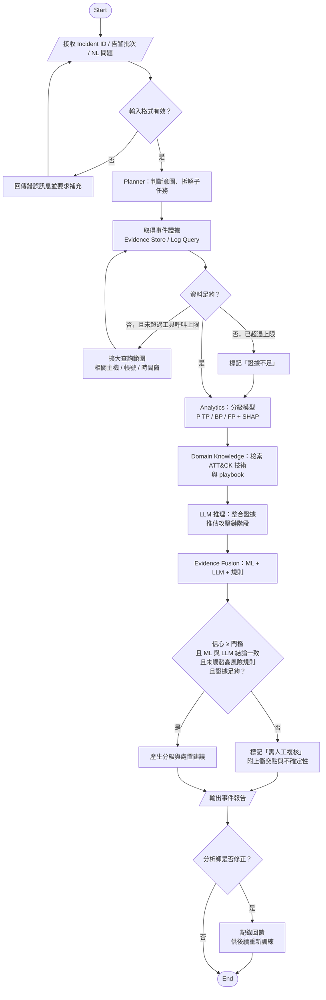

# AI SOC Analyst Agent：結合 MITRE ATT&CK 領域知識與 LLM 推理的資安告警分級代理人

> Final Project Proposal — AIOT
> 第 16 組：蘇恩平、周妤、袁靖淇、蕭宥瑄
> Proposal 階段，2026 年 11 月

---

## 1. Abstract

**【A. Attention Getter】** 資安攻擊的規模與代價持續攀升。依國安局報告，2025 年中共對我國關鍵基礎設施的網路侵擾平均每日約 263 萬次，較 2024 年增加 6% [23]；IBM 2026 年報告指出，資料外洩的全球平均成本創新高，達 499 萬美元（較前一年增加 12%），從發生到偵測、圍堵平均需要 247 天 [14]。站在第一線的資安維運中心（SOC）每天面對數以萬計的告警，其中只有一小部分對應真實攻擊 [2]。

**【B. But】** 大量誤報與良性觸發造成告警疲勞，讓分析師可能漏看真正的威脅 [8][24]。現有解法各有限制：ML 分級模型可大規模部署 [1][7]，但較少說明告警在攻擊鏈中的意義；LLM Agent 能調查與解釋，但近期研究發現，五種主流 LLM 推理策略都漏判至少 40.4% 的攻擊告警 [3]，在資安調查 benchmark 上最佳模型也只達到 0.606 的 reward [4]。此外，自動化程度提高會讓分析師降低監控、更依賴自動化結果 [12]。

**【C. Cure】** 為了解決上述問題，本專題提出一個結合 ML 分級、MITRE ATT&CK 領域知識與 LLM 推理的 **AI SOC Analyst Agent**，對資安事件提供有證據、可解釋，並且「知道何時該交給人」的分級與處置建議。

**【D. Development】** 系統以 LLM 作為規劃與推理核心，透過工具取得事件證據；以 Gradient Boosted Trees 預測事件為真陽性（TP）、良性陽性（BP）或誤報（FP）的機率，並用 SHAP 解釋；以向量資料庫檢索 ATT&CK 技術知識與 NIST SP 800-61 Rev. 3 處置流程；最後由證據融合模組整合 ML、LLM 與攻擊鏈規則的結論。當信心不足、結論衝突、證據不足或攻擊推進到後段階段時，系統會主動升級給人工複核。

**【E. Experiments】** 本專題以 Microsoft GUIDE（約 100 萬起真實事件，標籤由資安分析師標註）評估分級表現，並以 ExCyTIn-Bench 評估 Agent 查詢 log 進行調查的能力。比較對象包括多數類別、Detector 歷史誤報率規則、純 GBDT 及純 LLM；指標包括 Macro-F1、TP 漏判率、人工升級率、ATT&CK 對應準確率、報告品質與成本，並以消融實驗檢驗各模組的貢獻。

**【F. Expected Outcomes】** 本專題尚未進行實驗。我們預期：（1）整合領域知識與升級機制後，TP 漏判率將低於純 GBDT 與純 LLM baseline；（2）漏判率與升級率之間的取捨可被量化呈現，作為實務設定門檻的依據；（3）ATT&CK 知識檢索可提升攻擊技術對應的正確性與報告的可解釋性。實際結果將於期末報告中呈現。

**關鍵字**：Security Operations Center、Alert Triage、LLM Agent、MITRE ATT&CK、Retrieval-Augmented Generation、Human-in-the-loop

## 2. Introduction

### 2.1 Attention Getter：攻擊越來越多，偵測越來越慢

網路攻擊已是日常的國安與經濟威脅。國安局報告指出，2025 年中共對我國關鍵基礎設施的網路侵擾平均每日約 263 萬次，較 2024 年增加 6% [23]。攻擊者一旦入侵成功，往往不會立即被發現：Mandiant M-Trends 2026 報告指出，2025 年攻擊者在受害環境中的全球潛伏時間中位數為 14 天，比前一年的 11 天更長，網路間諜與北韓 IT 人員案件更長達 122 天 [15]。IBM 2026 年報告則顯示，資料外洩的全球平均成本創新高，達 499 萬美元（較前一年增加 12%），從發生到偵測、圍堵平均需要 247 天；而大量使用 AI 與自動化的組織平均可節省 193 萬美元，並將處理週期縮短 65 天 [14]。

這些數字指向同一個結論：**偵測和回應的速度直接決定損失大小，而 AI 有機會在其中發揮關鍵作用。**

### 2.2 Background：SOC 如何運作

資安維運中心（Security Operations Center, SOC）是企業偵測與回應資安事件的核心單位。各種防護產品（端點防護、郵件閘道、身分驗證、雲端服務等）會依偵測規則產生告警，再由 SIEM 或 XDR 平台彙整。分析師通常分為兩層：

- **Tier-1** 負責初步分級（triage），判斷告警是真陽性（TP，真實惡意活動）、良性陽性（BP，偵測正確但活動是授權或無害的）還是誤報（FP，偵測邏輯本身有誤）。實務上，分析師口中的「誤報」多半其實是 BP：告警正確，但該活動在組織內是被允許的 [24]。
- **Tier-2 / Tier-3** 負責深入調查、圍堵與復原。

分級時，分析師需要查詢相關 log、確認帳號與主機的上下文，並將告警對應到 MITRE ATT&CK 等攻擊知識框架，判斷攻擊推進到哪個階段 [10][22]。處置流程則依循 NIST SP 800-61 Rev. 3 等事件應變標準 [13]。

**與 AIoT 的關聯**：企業網路中的 IoT 與工控（OT）裝置多半無法安裝端點防護，其異常通常透過網路與身分層的告警進入 SOC，同樣需要分級。本專題以事件為單位整合不同來源的告警，並以 ATT&CK 推理攻擊鏈，不限於特定裝置類型；ATT&CK 另有 ICS 矩陣，可延伸至工控情境。

### 2.3 Problem：分級是瓶頸

SOC 每天面對數以萬計的告警，其中只有一小部分對應真實攻擊 [2]；大型 SOC 同時有數百起事件待處理，排序方式卻常僅依到達時間或粗略的嚴重度 [7]。這造成**告警疲勞**：大量誤報讓分析師疲於奔命，真正的攻擊反而被淹沒 [8][9]。

本專題要解決的問題是：

> **能否設計一個 AI Agent，結合 ML、資安領域知識與 LLM 推理，對資安事件提供有依據、可解釋，並且知道何時該交給人的分級與處置建議？**

### 2.4 Existing Limitations：現有方法的不足

1. **ML 分級缺少攻擊鏈脈絡**：Microsoft 的 ML 分級與排序系統已可大規模部署 [1][7]，但模型主要判斷「像不像過去的 TP」，較少明確說明告警在攻擊鏈中代表什麼；而攻擊鏈脈絡正是判斷嚴重度的關鍵 [10][11]。
2. **LLM Agent 漏判率高**：LLM Agent 能主動查詢與解釋，但研究發現五種主流推理策略都漏判至少 40.4% 的攻擊告警，而且常在「查無紀錄」時過早結案 [3]；在資安調查 benchmark 上，最佳模型的 reward 只有 0.606 [4]；推理模型在資安分析上的進步也不如在程式與數學上明顯 [5]。
3. **領域知識未被整合**：ATT&CK 對應方法多處理威脅情資文字 [6]，以攻擊鏈判斷嚴重度的方法則多為規則或攻擊圖 [10][11]，兩者都沒有與 ML 分級、LLM 推理整合。
4. **缺少人機協作設計**：多數系統只輸出結論。研究顯示，自動化程度提高後分析師會降低監控、更依賴自動化結果，而系統性的驗證程序能減緩這個現象 [12]；實地部署也顯示，分析師是否採用 AI 的輸出，關鍵在於結果是否容易驗證 [26]。
5. **評估難以重現**：AI 告警篩選研究普遍缺乏實際營運驗證與一致的評估方法 [8]；常用的 CICIDS2017 資料集被發現在流量建構與標註上有問題，超過 20% 的流量需要重建或重新標註 [17]；ML 資安研究中的評估陷阱相當普遍 [16]。

### 2.5 Innovation：本專題的不同之處

| 面向 | 既有方法 | 本專題 |
|---|---|---|
| 判斷方式 | 單一 ML 模型，或單一 LLM | **證據融合**：ML 機率、LLM 推理、攻擊鏈規則三方整合 |
| 領域知識 | 隱含在訓練資料中，或只用於威脅情資文字 | **明確整合** ATT&CK 知識庫與 Kill Chain 規則，攻擊越後段越傾向升級 |
| 不確定性 | 只輸出分級結果 | 信心不足、ML 與 LLM 結論衝突、觸發高風險規則或證據不足時，**主動升級並說明原因** |
| 證據不足時 | LLM 可能直接結案 [3] | 依 **Assume Breach** 原則擴大查詢，預算用完仍不確定就升級 |
| 可解釋性 | 分數或簡短理由 | 每個結論附 **證據鏈**（SHAP 特徵、相似事件、ATT&CK 技術、資料來源） |
| 評估 | 只看準確率 | 同時報告 **漏判率與升級率**，並在兩個公開資料集上可重現評估 |
| 與最接近的研究 AIDA [3] 相比 | 推理、質疑與裁判都由 LLM 完成；在單一資料系列上評估；每告警約 3.4 萬 token | 分級機率來自在真實標籤上訓練的 GBDT，LLM 不單獨決定；ATT&CK 知識與攻擊鏈規則作為硬性約束；升級條件是可檢查的規則；在 6.1k 個組織的 GUIDE 上評估 |

### 2.6 Contributions：預期貢獻

1. **系統貢獻**：設計並實作一個整合 ML 分級、ATT&CK 知識檢索與 LLM 推理的 SOC 分級 Agent，模組依 ① 到 ⑧ 的架構清楚分工，可供後續開發者延伸。
2. **方法貢獻**：提出證據融合與升級演算法（Algorithm 1、2），把 Assume Breach、攻擊鏈脈絡、錯誤成本不對稱等領域原則轉成明確的決策規則。
3. **實驗貢獻**：在 GUIDE 與 ExCyTIn-Bench 兩個公開資料集上，與規則、純 ML、純 LLM 等 baseline 比較，並以消融實驗量化各模組的貢獻；以事件與組織為單位切分資料，避免資料洩漏。
4. **領域研究貢獻**：整理 SOC 領域的五個核心思維模式、三個專業爭論與十個深度理解問題，並說明它們如何轉化為系統設計。
5. **可重現與交接**：公開原始碼、資料處理流程、README 與 DESIGN.md，讓其他開發者可以理解、執行、驗證並延續本專題。

## 3. Related Work

> 本節文獻共 16 篇：AI Technology 8 篇（[1]–[7]、[26]）、Domain Know-how 8 篇（[8]–[13]、[24]、[25]）。
> Limitation 欄位標示「作者自述」者取自原文的限制章節；其餘依原文內容整理。

### 3.1 AI Technology

**(1) ML 告警分級與優先排序。** Microsoft 的 Copilot Guided Response（CGR）[1] 以 ML 架構同時處理調查（相似歷史事件）、分級（TP / BP / FP）與處置建議三項任務，並公開了 GUIDE 資料集：約 1,300 萬筆證據、100 萬起事件，標籤由真實客戶的資安分析師標註，是目前最大的公開真實事件資料集。同團隊的 AIP [7] 進一步處理「事件佇列該怎麼排序」的問題，把資訊檢索的 BM25 概念改寫為不需查詢、跨租戶的排序演算法，在專家評估中達到 92.8% Precision@10，並在 GUIDE 上補上 9,980 個事件的優先排序標籤。這兩篇顯示 ML 方法在大規模 SOC 已可實際部署，但其優勢來自廠商內部的跨客戶資料與產品脈絡。

**(2) LLM Agent 用於告警調查。** CORTEX [2] 以多 Agent 分工（行為分析、證據蒐集、推理）處理告警分級，並指出單一 LLM 面對雜訊多的企業資料時表現不穩、透明度不足。Tsegai 等人 [3] 更系統性地比較五種 tool-using LLM 推理策略，發現**所有方法都漏掉至少 40.4% 的攻擊相關告警**；漏判常發生在「查詢沒有回傳紀錄」時，而且在同一個 context 內自我檢查反而淨效果為負。他們提出的 AIDA 透過獨立質疑與裁判機制，將漏判率降到 3.1%（F1 0.958），代價是 18.4% 的告警被升級給人工。這說明 **Agent 的「何時該停止調查、何時該交給人」是設計重點**。

**(3) 資安 LLM Benchmark。** ExCyTIn-Bench [4] 在一個受控的 Azure 租戶中（57 張 log 表、8 條真實攻擊鏈、7,542 題）評估 LLM Agent 的威脅調查能力，目前最佳模型 reward 只有 0.606。CyberSOCEval [5] 評估惡意程式分析與威脅情資推理，發現推理模型的 test-time scaling 在資安分析上的效益不如在程式和數學上明顯。兩者都顯示**通用 LLM 在資安推理上仍有明顯落差**。

**(4) 領域知識檢索（RAG）。** TechniqueRAG [6] 以 retriever + 指令微調 LLM + 零樣本重排序，將威脅情資文字標註為 ATT&CK 技術，只需少量標註資料即達到 state-of-the-art。不過它處理的是**威脅情資報告的文字**，而非 SOC 告警與 log；作者也指出模型很少輸出超過兩個技術，多標籤情境的召回率偏低。

**(5) LLM Agent 的實地部署。** Banstola 等人 [26] 在一所大學的 SOC 進行 14 個月的實地研究，與分析師一起設計並部署 LLM Agent；在最後 4 個月的使用期間，超過 90% 的情況下分析師沿用了 Agent 的輸出來撰寫結案報告；對最常使用的 3 位分析師，估計節省 30–50% 的處理時間（對照為分析師自陳的手動處理時間）。他們發現**影響採用最大的不是準確率，而是輸出是否容易驗證**；分析師能自行調整 Agent 的行為後，也更信任它的結果。

### 3.2 Domain Know-how

**(1) 告警疲勞是 SOC 的結構性問題。** Ndichu 等人 [8] 回顧 2015–2026 年共 87 篇核心研究，將告警篩選流程歸納為過濾、分級、關聯、生成式增強四階段，並指出領域長期缺乏：實際營運驗證、對抗穩健性、跨環境泛化、評估方法一致性。Habibzadeh 等人 [9] 的 LLM-for-SOC 綜述則把 SOC 的困境歸結為告警量大、人力不足、專家需求高、回應延遲，以及威脅情資難以有效運用。

**(2) 攻擊鏈階段決定嚴重程度。** Sadlek 等人 [10] 將偵測到的告警序列對應到依 ATT&CK 技術產生的 Kill Chain 攻擊圖，以「攻擊推進到的最遠階段」和「資產重要性」判定嚴重度，分類告警序列的 AUC 達 0.95。ROSCA [11] 同樣以 ATT&CK Kill Chain 為基礎，把告警依共同屬性聚合成 case 並評分排序，在真實告警資料上優於 MATE 框架。兩者共同支持一個領域共識：**單一告警的意義取決於它在攻擊鏈中的位置與上下文**。

**(3) 人機協作的風險：自動化自滿。** Tilbury 與 Flowerday [12] 以 SOC 實地觀察、696 名分析師問卷與 29 名分析師訪談發現：自動化程度提高後，分析師會降低監控、更依賴自動化結果（automation complacency），而**系統性的驗證程序**能減緩這個現象。這表示 AI Agent 不能只追求準確率，還必須設計讓人類「有理由去檢查」的輸出。

**(4) 事件應變標準。** NIST SP 800-61 Rev. 3 [13]（2025 年 4 月）取代 2012 年的 Rev. 2，將事件應變改以 CSF 2.0 的六大功能（Govern、Identify、Protect、Detect、Respond、Recover）重新組織，是本專題處置建議的流程依據。

**(5) 分析師實際如何判斷告警。** Alahmadi 等人 [24] 訪談 7 個 SOC 的 21 名實務人員，發現大量被稱為「誤報」的告警其實是 **benign trigger**：告警本身正確，但活動在組織內是被允許的，因此主張把「真正的誤報」和「良性觸發」分開衡量；分析師也指出，告警缺乏解釋與脈絡是主要問題之一。Kersten 等人 [25] 與一家商業 SOC 合作，以放聲思考（think-aloud）觀察 5 名 Tier-1 分析師進行的 400 次調查，發現調查流程因人、因告警類型而異，而且**最後需要升級的告警，分析師會蒐集更多種類的資訊**。這兩篇說明分級不只是「是不是攻擊」的二分判斷，也說明證據蒐集的深度應該依情況調整。

### 3.3 Article Summary Table

| Ref. | Year | Problem | AI Method | Domain Knowledge | Dataset | Findings | Limitation |
|---|---|---|---|---|---|---|---|
| [1] | 2024 | SOC 事件的調查、分級、處置建議 | ML 架構（CGR），整合於 Defender XDR | SOC triage（TP/BP/FP）、處置動作 | GUIDE（1,300 萬證據、160 萬告警、100 萬事件、6.1k 組織、兩週，公開） | 已部署至數千客戶、產生數百萬筆建議；以內部資料離線評估，分級跨區域平均 macro-F1 0.87、precision 0.87、recall 0.86；在 90% precision 的門檻下，分級模型可覆蓋約 41% 的事件（GUIDE 本身未報告分級分數） | 作者自述：未與其他模型或商用產品比較；只能針對既有偵測器給建議，無法處理 zero-day 或未監控的攻擊途徑 |
| [2] | 2025 | 告警量大、單一 LLM 雜訊下不穩且不透明 | 多 Agent LLM（行為分析、證據蒐集、推理） | SOC 調查流程、分析師逐步行動 | 自建並公開的 SOC 調查軌跡（10 餘個真實企業情境、數千筆） | 相較使用工具的單 Agent：可行動告警 F1 0.66 → 0.78，誤報率 24.9% → 14.2% | 作者自述：情境數有限；對分布偏移、prompt injection、工具回傳不完整敏感。成本：token 約 5.7 倍、每告警 152 秒（約 3.4 倍） |
| [3] | 2026 | LLM Agent 的推理策略如何影響證據蒐集與結案時機 | 5 種 tool-using LLM 策略；提出 AIDA（多 Agent 質疑 + Judge） | 告警分級、SIEM 調查 | ALERT-BENCH：以 AIT-LDSv2 telemetry 在 SIEM 重播；1,247 筆告警，來自四天的多階段攻擊情境 | 現有方法漏判 ≥ 40.4%，且查無紀錄時最易誤判結案；AIDA F1 0.958、漏判率 3.1%，升級 18.4%；每告警約 3.4 萬 token、12.7 秒、0.109 美元（GPT-4.1） | 作者自述：資料僅來自 AIT 同一資料系列，未在獨立收集的 SOC 資料上驗證；缺乏組織脈絡（帳號角色、資產用途）時部分事件仍無法判斷；未評估分析師實際使用情形；預印本 |
| [4] | 2026 | 缺乏評估 LLM Agent 威脅調查能力的 benchmark | LLM Agent + SQL 工具；由調查圖自動生成題目 | 資安 log、調查圖、偵測邏輯 | 單一受控 Azure 租戶（虛構公司）：57 張 log 表、8 條真實攻擊鏈、7,542 題 | 最佳模型 reward 0.606；改用完整資料庫降至 0.248；移除告警表後表現明顯下降 | 依內文整理（無獨立限制章節）：僅一個租戶，良性雜訊為模擬產生；題目由 LLM 依告警圖生成，偏重告警表 |
| [5] | 2025 | 惡意程式分析與威脅情資推理缺乏 benchmark | LLM 評估（含推理模型） | 惡意程式分析、威脅情資 | CyberSOCEval（CyberSecEval 4 的一部分）：惡意程式分析 609 題、威脅情資推理 588 題（45 份報告） | 各模型準確率約 23–34%（惡意程式）、43–53%（威脅情資），遠未飽和；模型越大越新越好；test-time scaling 在資安的效益不如程式與數學 | 作者自述：惡意程式分析只涵蓋 Windows；皆為多選題；事件應變與分級列為未來工作，尚未涵蓋 |
| [6] | 2025 | 從資安文字辨識 ATT&CK 技術，需大量標註 | RAG：retriever + 指令微調 LLM + 零樣本重排序 | MITRE ATT&CK 技術 | Tram、Procedures、Expert 三個 benchmark（分別涵蓋 198、488、290 種技術） | 少量標註即達 SOTA：Procedures F1 91.09%；多標籤的 Expert 僅約 50%（GPT-4o + RAG 51.30% 略高） | 作者自述：許多技術缺乏程序範例；訓練資料多為單一標籤，模型很少輸出超過兩個技術，多標籤召回率低；標準答案本身不一致。另：僅處理威脅情資文字，而非告警或 log |
| [7] | 2026 | 事件佇列依時間或粗略嚴重度排序，優先順序不明 | 改良 BM25 的跨租戶排序 + 元件層級解釋 | SOC 佇列管理、領域先驗 | 1,000 個組織專家評估；47.3 萬個組織日佇列的上線後紀錄；GUIDE + 9,980 筆排序標籤（499 個佇列） | Precision@10 92.8%；告警細節檢視比嚴重度排序多 17.5% | 作者自述：只排序既有佇列，不判斷 TP/FP，也無法找出未成為事件的攻擊；排序品質依賴 ATT&CK 對應、威脅情資與資產標籤等 metadata 的完整性 |
| [8] | 2026 | 告警疲勞的 AI 解法缺乏系統性整理 | 綜述：過濾、分級、關聯、生成式增強 | 告警疲勞、SOC 工作流程 | 119 筆文獻，其中 87 篇核心研究（2015–2026） | 提出四階段分類；指出營運驗證、對抗穩健性、跨環境泛化與評估方法四項缺口，並提出「Cognitive SOC」研究議程 | 作者自述：排除非英文文獻；多數研究以 CICIDS、DARPA TC 等 benchmark 評估，量化結果應視為上限；為投稿 ACM Computing Surveys 的預印本 |
| [9] | 2025 | LLM 如何整合進 SOC 工作流程 | 綜述：LLM 用於 log 分析、告警分級、威脅情資 | SOC 的人力、告警量、回應時間問題 | 依 Kitchenham 系統性文獻回顧方法整理的文獻 | 作者自稱為第一篇全面探討 LLM 在 SOC 應用的綜述；依 SOC 工作流程分類各項應用 | 無實證結果（綜述性質）；預印本 |
| [10] | 2025 | 多步驟攻擊的告警需依嚴重度分級 | 攻擊圖比對（MulVAL），非 LLM | Kill Chain、ATT&CK、資產重要性 | 10 台主機的測試平台，以 MITRE CALDERA 執行 5 個攻擊情境（31 種 ATT&CK 技術）；475 條告警序列中 10 條為惡意 | 告警序列分類 AUC 0.95；門檻可正確分出 80% 惡意序列 | 作者自述：測試平台規模小、無真實使用者流量；攻擊圖在大型網路有擴展性問題；MulVAL 規則需人工撰寫，維護成本高 |
| [11] | 2025 | 告警量大造成分析師疲勞；SOC 依賴黑箱商用方案，難以理解與自行調整 | 非 ML：依共享欄位建立動態告警圖，聚合成 case，再依 ATT&CK 戰術推進評分（輕量、可解釋） | ATT&CK 戰術推進（Kill Chain） | 法國醫院 SOC：EDR 告警（2 個月、382 筆）與內部 IDS 告警（15 天、37 筆），以分析師人工標籤評估；另含滲透測試資料 | 分數比 MATE 更符合分析師標籤，分析師確認分數有用；382 筆告警的關聯只需 0.12 秒、1.45 MB | 單一醫院、告警數量少；以分數與標籤的對應圖呈現，未報告 Precision / Recall 等量化指標；只納入能確定推得戰術的告警 |
| [12] | 2026 | SOC 自動化是否造成分析師自滿與偏誤 | 非 AI 方法：PLS 結構方程模型 | 自動化自滿與偏誤、人機信任 | 4 次 SOC 觀察、696 份問卷、29 場訪談 | 分析師降低監控、更依賴自動化；系統性驗證程序可減緩 | 僅美國分析師；自陳資料 |
| [13] | 2025 | 事件應變指引需與 CSF 2.0 整合 | — | 事件應變生命週期（CSF 2.0 六大功能） | — | 取代 2012 年 Rev. 2；建議事件須先分級與驗證（RS.MA-02），且不應依先到先處理 | 以 CSF 成果與建議呈現的高階指引，不提供告警層級的判斷規則或門檻 |
| [24] | 2022 | 安全工具誤報率高，但「誤報」的定義含糊 | 非 AI 方法：問卷（n = 20）＋半結構式訪談（n = 21） | 分析師如何驗證告警、誤報與 benign trigger 的區別 | 7 個 SOC 的實務人員，多數位於英國 | 多數「誤報」其實是 benign trigger，應與真正的誤報分開衡量；告警的主要問題是不可靠、無法客製、缺乏解釋與脈絡；提出 REACT 模型 | 作者自述：樣本小、僅 7 個 SOC 且多在英國與歐洲；非隨機招募；自陳資料 |
| [25] | 2025 | Tier-1 分析師實際如何調查告警，所知甚少 | 非 AI 方法：兩次 think-aloud 實驗，並開發調查輔助系統（AISS） | Tier-1 調查流程、會蒐集哪些資訊 | 一家商業 SOC：5 名分析師 400 次調查；另 4 名分析師使用 AISS 進行 36 次調查 | 調查流程因人、因告警類型而異；需要升級的告警會蒐集更多種類的資訊；AISS 讓分析師以更少動作取得更多相關資訊 | 作者自述：僅一家 SOC，受試者多為實習的初階分析師；同一攻擊被重複調查 |
| [26] | 2026 | LLM Agent 在真實 SOC 中是否會被採用 | LLM ReAct Agent，與分析師共同設計 | SOC 工單處理流程、分析師的信任與採用 | 一所大學 SOC 的 14 個月實地研究，最後 4 個月由分析師實際使用 | 超過 90% 的情況下輸出被用於結案報告；可驗證性是採用的關鍵；最常使用的 3 位分析師估計節省 30–50% 處理時間 | 作者自述：僅一所大學 SOC；時間比較的對照為分析師自陳的手動處理時間；預印本 |

### 3.4 Research Gap

**Existing Research**
- **ML 分級**（[1]、[7]）：可大規模部署、準確，但依賴廠商內部資料，攻擊鏈脈絡沒有明確納入推理。
- **LLM Agent**（[2]、[3]、[4]）：能調查與解釋，但漏判率高（[3] 中現有方法 ≥ 40.4%）、benchmark 分數有限（[4] 最佳 0.606）。
- **知識整合**（[6]、[10]、[11]）：ATT&CK / Kill Chain 能有效判斷嚴重度，但多為規則或圖方法，或只處理威脅情資文字，沒有和 ML 分級、LLM 推理整合。
- **SOC 實務與人因研究**（[12]、[24]、[25]、[26]）：自動化會讓分析師降低監控；分析師需要可解釋、有脈絡、容易驗證的輸出；需要升級的告警需要更多樣的證據。

**Limitations**
1. ML 方法擅長「判斷像不像」，但很少說明「在攻擊鏈中代表什麼」。
2. LLM Agent 在證據不足時容易過早結案，且單純增加推理量不會改善可靠性（[3]）。
3. 多數系統只輸出結論，缺少「何時該交給人」的明確設計，也不容易讓分析師驗證，容易加劇自動化自滿（[12]、[26]）。
4. 綜述 [8] 指出評估方法不一致、缺乏可重現的公開評估。

**Research Gap**
目前缺少一個**同時整合「真實標籤上訓練的 ML 分級」、「ATT&CK / Kill Chain 領域推理」與「LLM 證據整合」**，並以**明確的升級機制**處理不確定性與證據不足、且**在公開資料上可重現評估**的 SOC Agent。

**Our Project**
本專題提出 AI SOC Analyst Agent：
- 以 GUIDE 訓練 ML 分級模型，負責大量、穩定的機率判斷，不讓分級只依賴 LLM（回應 Limitation 2）。
- 以 ATT&CK 知識庫與 Kill Chain 規則提供領域推理，越後段的攻擊鏈階段越傾向升級（回應 Limitation 1）。
- 以證據融合與衝突偵測決定是否交給人工，並把「TP 漏判率」與「升級率」同時列為指標，明確呈現兩者的取捨（回應 Limitation 2、3）。
- 每個結論都附上證據鏈與資料來源，讓分析師容易驗證，而不是只能照單全收（回應 Limitation 3）。
- 以 GUIDE 和 ExCyTIn-Bench 兩個公開資料集評估，確保可重現（回應 Limitation 4）。

## 4. Deep Research

> 本節回答作業要求的三個問題：Q1 SOC 專家普遍認同的五個核心思維模式；Q2 三個最重要的專業爭論；Q3 用來分辨「真正理解」和「死記硬背」的十個問題。
> 每個思維模式和爭論都對應到本專題的具體設計決策。

### Q1. 五個核心思維模式

#### M1. Assume Breach：假設已遭入侵

- **意義**：不要預設環境是乾淨的。「查不到可疑紀錄」不等於「沒有攻擊」，也可能是攻擊者刪了 log、或是查詢範圍不夠。
- **證據**：
  - M-Trends 2026 [15]：2025 年攻擊者在環境中的全球潛伏時間中位數為 **14 天**（前一年 11 天）；網路間諜與北韓 IT 人員案件更長達 **122 天**。
  - NIST Zero Trust Architecture [21] 的基本假設是：企業網路內的資產應「隨時假設攻擊者已存在於網路中」，不因位於內部而被信任。
  - [3] 的實驗發現：LLM Agent **在查詢沒有回傳紀錄時，最容易把攻擊告警誤判為無害並結案**。
- **對系統設計的影響**：Agent 遇到「查無紀錄」時不可直接判為 BP / FP，而是擴大查詢範圍（相關主機、帳號、時間窗）；用完工具呼叫預算仍無法確認，就升級給人工（Flowchart 的「資料足夠？」迴圈；Algorithm 1 第 05–09、18 行）。

#### M2. 看事件與攻擊鏈脈絡，而非單一告警

- **意義**：單一告警本身的意義有限。同樣是「執行 PowerShell」，單獨出現可能是管理員作業；如果接在可疑登入之後、又接著大量外傳資料，就是攻擊鏈的一部分。
- **證據**：
  - [10] 把告警序列對應到 Kill Chain 攻擊圖，以攻擊推進到的最遠階段判定嚴重度，分類 AUC 達 0.95。
  - [11] ROSCA 以 ATT&CK Kill Chain 聚合告警，排序準確度優於 MATE 框架。
  - GUIDE [1] 的分級標籤本身就是標在**事件（incident）層級**，而不是單一告警。
- **對系統設計的影響**：分析單位是「事件」而非「告警」（Evidence → Alert → Incident 三層聚合）；特徵包含 ATT&CK Tactic 覆蓋數與攻擊鏈階段；攻擊推進到後段（例如 Exfiltration）時觸發高風險規則。

#### M3. 錯誤成本不對稱：漏判比誤報昂貴，但誤報也有代價

- **意義**：漏掉一個真實攻擊（False Negative）的代價遠高於多看一個誤報；但誤報太多會造成告警疲勞，反過來讓分析師漏看真正的攻擊。兩者都要管理，不能只看準確率。
- **證據**：
  - IBM 2026 [14]：資料外洩的全球平均成本為 **499 萬美元**，從發生到偵測、圍堵的平均週期為 **247 天**；大量使用 AI 與自動化的組織平均節省 **193 萬美元**、週期縮短 **65 天**。
  - [8] 指出告警疲勞是 SOC 的結構性問題；[3] 顯示降低漏判（40.4% → 3.1%）需要付出 18.4% 升級率的代價。
- **對系統設計的影響**：TP 漏判率是首要指標（NFR2）；Algorithm 2 第 06–08 行在高風險情境下偏向升級；實驗同時報告「漏判率」與「升級率」，明確呈現取捨。

#### M4. 看攻擊行為（TTPs），而非容易替換的指標（IOCs）

- **意義**：IP、網域、檔案 hash 這類指標，攻擊者很容易更換；攻擊手法（Tactics, Techniques, Procedures）則難以改變。這是 Pyramid of Pain [20] 的核心概念，也是 MITRE ATT&CK [22] 以「攻擊者行為」為單位建構知識庫的原因。
- **證據**：
  - Pyramid of Pain [20]：越往上層（TTPs）偵測，攻擊者要付出的代價越高。
  - M-Trends 2026 [15]：初始入侵途徑中，漏洞利用占 32%、語音釣魚占 11%、先前已入侵占 10%，而電子郵件釣魚降到 6%。攻擊手法持續變化，只比對已知指標不足以應對。
- **對系統設計的影響**：以 ATT&CK 技術作為領域知識的核心單位（⑥ Domain Knowledge）；分級模型避免過度依賴 IP、hash 這類容易變動的特徵，以免學到捷徑。

#### M5. 自動化要可驗證，人保留最終判斷

- **意義**：AI 可以加速分級，但分析師必須能理解並檢查 AI 的依據；如果分析師只會照單全收，系統反而會變得更危險。
- **證據**：
  - [12]（696 份問卷、29 場訪談）：自動化程度提高後，分析師降低監控、更依賴自動化結果；**系統性的驗證程序**能減緩這個現象。
  - [18]（720 份問卷）：分析師偏好「全人工」或「全自動」兩個極端，對中間的協作模式興趣不高，使人機協作更難推行。
  - [26]（14 個月實地部署）：分析師是否採用 AI 的輸出，關鍵在於**是否容易驗證**，而不只是準確率。
  - NIST SP 800-61 Rev. 3 [13] 把事件應變放在組織治理（Govern）與風險管理之下，責任仍在組織與人身上。
- **對系統設計的影響**：每個結論都附上證據鏈與來源（NFR1）；ML 與 LLM 結論衝突時明確標示衝突點，而不是只給一個答案；設置「需人工複核」狀態，並在報告中說明為什麼需要人看。

### Q2. 三個最重要的專業爭論

#### 爭論 1：全自動 AI SOC ↔ 人機協作（AI 輔助分析師）

| | 觀點 A：應走向全自動 AI SOC | 觀點 B：AI 只能輔助，人必須在迴圈內 |
|---|---|---|
| **主張** | 告警量已超過人力負荷，只有自動化才能跟上 | 現階段 AI 在資安推理上仍不可靠，全自動會放大錯誤 |
| **最有力證據** | IBM 2026 [14]：大量使用 AI 與自動化的組織平均節省 193 萬美元、週期縮短 65 天；Microsoft 已在大規模環境部署 ML 分級與排序 [1][7] | [3]：五種 LLM Agent 策略都漏判 ≥ 40.4% 的攻擊告警；[4] 最佳模型 reward 只有 0.606；[5] 指出 LLM 遠未達到 benchmark 上限；[12] 顯示自動化會造成分析師自滿 |

- **目前共識**：由 AI 處理大量、低風險、高信心的告警，高風險或不確定的事件交給人判斷；AI 的價值在於「縮短調查時間、提供依據」，而非取代決策。[3] 的 AIDA 與 [2] 的 CORTEX 都在不確定時把告警升級給人；[26] 的實地部署中，Agent 只提供分析，結案仍由分析師決定。
- **尚未解決的問題**：
  1. 升級門檻要怎麼校準？[3] 的 AIDA 用 18.4% 的升級率換取 3.1% 的漏判率，這個比例在不同規模的 SOC 是否可接受？
  2. AI 判錯時責任歸屬為何？
  3. 分析師本身偏好「全人工」或「全自動」兩極 [18]，中間的協作模式要如何設計才會被採用？
- **本專題的立場**：採觀點 B 的人機協作，但用 ML 處理大量判斷以回應觀點 A 的效率需求；實驗同時報告漏判率與升級率，讓取捨可被量化討論。

#### 爭論 2：規則式偵測（Detection Engineering）↔ 機器學習

| | 觀點 A：規則式偵測與分級 | 觀點 B：ML / AI 驅動的偵測與分級 |
|---|---|---|
| **主張** | 規則透明、可稽核、可直接對應 ATT&CK，誤報可透過調校控制 | 規則無法涵蓋未知攻擊，維護成本隨規模爆炸；ML 能從大量資料中學到人寫不出來的模式 |
| **最有力證據** | Sommer & Paxson [19] 指出 ML 用於入侵偵測有根本困難：錯誤成本高、偵測結果與語意之間有落差、網路流量本身高度多樣；Arp 等人 [16] 分析 30 篇頂級會議論文，發現 ML 資安研究普遍存在評估陷阱；[10]、[11] 以 Kill Chain 規則與攻擊圖就能有效排序 | [1]、[7] 的 ML 分級與排序已在數千個組織部署；[8] 回顧 87 篇研究，AI 告警篩選是持續成長的方向 |

- **目前共識**：混合式架構。已知攻擊用規則偵測，ML 用來排序、分級與降低誤報，規則與領域知識則作為 ML 的約束與解釋。[8] 把 AI 告警篩選定位為偵測器產生告警之後的下游工作；[1]、[7] 的 ML 分級與排序也都建立在既有偵測器的告警之上。
- **尚未解決的問題**：
  1. **對抗穩健性**：攻擊者可以刻意讓行為看起來像良性活動，[8] 將此列為主要缺口。
  2. **概念漂移**：模型上線後環境與攻擊手法改變，多久需要重新訓練？
  3. **跨環境泛化**：在 A 公司訓練的模型能否用在 B 公司？[8] 同樣列為缺口。
- **本專題的立場**：混合式。ML（GBDT）負責機率判斷，Kill Chain 規則提供硬性約束（Algorithm 2 第 06–08 行），LLM 負責整合與解釋。

#### 爭論 3：公開資料集與 Benchmark 能否代表真實 SOC？

| | 觀點 A：公開資料集是可重現研究的基礎 | 觀點 B：公開資料集與真實環境落差大，結果容易高估 |
|---|---|---|
| **主張** | 沒有公開資料就無法比較方法、重現結果；新一代資料集已更接近真實 | 資料集的標註錯誤、取樣偏差與不當切分，使論文中的高分無法反映實際表現 |
| **最有力證據** | GUIDE [1] 是來自 6.1k 個組織的真實事件，標籤由真實分析師標註；ExCyTIn-Bench [4] 以自動生成題目提供可驗證的答案；AIP [7] 在 GUIDE 上補上排序標籤 | Engelen 等人 [17] 發現 CICIDS2017 在流量產生、流量建構、特徵擷取與標註上都有問題，修正後**超過 20% 的流量需要重建或重新標註**，對後繼的 2018 版初步檢查也發現流量建構錯誤；Arp 等人 [16] 分析近 10 年 30 篇頂級會議論文，指出取樣偏差、data snooping（訓練時用到實務上拿不到的資料，例如測試資料洩漏）等陷阱普遍存在；[8] 將「評估方法」列為領域主要缺口 |

- **目前共識**：公開資料集仍然必要，但需要使用多個資料集交叉驗證、避免已知的評估陷阱（例如隨機切分造成資料洩漏），並在論文中明確說明限制。[16] 列出取樣偏差、data snooping 等常見陷阱並提出對應建議；[8] 也提醒，在 benchmark 上得到的量化結果應視為上限。
- **尚未解決的問題**：
  1. 目前沒有同時具備「真實環境、完整原始 log、事件層級真實標籤」的公開端到端 SOC benchmark。GUIDE 有真實標籤但欄位匿名化，且依論文只涵蓋兩週；ExCyTIn 有完整 log 但只是單一受控環境。
  2. 隱私與商業機密限制了真實 SOC 資料的公開程度。
- **本專題的立場**：同時使用 GUIDE（真實標籤）和 ExCyTIn-Bench（完整 log 與調查推理），以事件和組織為單位切分資料以避免洩漏，並在 Limitations 中明確說明兩者各自的限制。

### Q3. 十個深度理解問題

> 每題附上「深入理解者應該能談到的重點」，可作為組內自我檢核與口頭報告準備。

| # | 類型 | 問題 | 深入理解者應該能談到的重點 |
|---|---|---|---|
| 1 | Why | 某個 Detector 有 90% 的告警最後都是 FP，為什麼 SOC 通常不直接把它關掉？ | 關掉就失去對該技術的偵測覆蓋；攻擊者正好可以躲在雜訊中；應該先區分是 FP（規則寫錯）還是 BP（行為真實但無害），再決定是調校規則、加白名單，還是改為事件層級關聯 |
| 2 | What-if | 如果攻擊者知道你的 Agent 在「查無相關紀錄」時傾向結案，他會怎麼做？你的系統要怎麼防？ | 攻擊者會刪除或停用 log（ATT&CK 的 Defense Evasion 戰術，例如清除指標）；「log 突然中斷」本身就是可疑訊號；呼應 Assume Breach 與 [3] 的發現；系統應把「資料缺失」當成需要升級的訊號，而非無害的證據 |
| 3 | Trade-off | 你的升級門檻 τ 要怎麼設定？如果把所有事件都升級給人，漏判率就是 0，為什麼這不是好答案？ | 漏判與誤報成本不對稱（M3），但分析師人力有限；升級太多會造成告警疲勞，反而讓人漏看；門檻應根據 SOC 人力與風險容忍度，在驗證集上依「漏判率–升級率」曲線選擇，而不是只看 F1 |
| 4 | Failure Case | 一個被 Agent 高信心判為 BP 的事件，後來證實是真實攻擊：攻擊者使用系統內建的管理工具（Living off the Land）。為什麼模型會失敗？ | 攻擊者使用合法工具時，行為特徵和管理員日常作業幾乎相同；BP 與 TP 的差異在於「意圖」與「上下文」（誰、何時、接在什麼之後），而非單一行為；解法是加入攻擊鏈脈絡（M2）、帳號與主機的基線行為，以及對這類技術降低自動結案的信心 |
| 5 | Evidence | 你要怎麼證明這個 Agent 真的對 SOC 有幫助，而不只是在資料集上分數高？ | 資料集分數可能因資料洩漏或取樣偏差而高估 [16][17]；應補充：漏判率與升級率、跨資料集評估、報告品質評分、分析師使用時的決策正確率與時間；並要檢查分析師是否因此產生自動化自滿 [12] |
| 6 | Comparison | TP、BP、FP 三者有什麼差別？為什麼區分 BP 和 FP 對 SOC 很重要？ | TP：真實惡意活動；BP：偵測正確但活動是被授權或無害的（例如資安團隊的滲透測試）；FP：偵測邏輯本身錯了。FP 需要修改偵測規則，BP 需要建立例外或白名單；混為一談會導致錯誤的調校方向；實務研究也發現多數「誤報」其實是 BP [24] |
| 7 | Design Decision | 為什麼本專題的分級主力是 GBDT，而不是直接讓 LLM 判斷？ | GUIDE 欄位多為匿名化 ID，LLM 無法從中讀出語意；GBDT 在大量結構化資料上便宜、穩定、機率可校準、可用 SHAP 解釋；[3] 顯示 LLM Agent 單獨分級漏判率高；LLM 的價值在整合知識、處理衝突與產生報告 |
| 8 | Real-world Scenario | 凌晨三點，同一個帳號先從海外 IP 登入成功，接著建立郵件自動轉寄規則，然後大量下載 SharePoint 檔案。你會怎麼分級與處置？ | 對應 ATT&CK：Initial Access（有效帳號）→ Persistence / Collection（郵件轉寄規則）→ Exfiltration；攻擊鏈已推進到後段，應判為高風險 TP 並升級；處置：停用帳號與工作階段、移除轉寄規則、保留證據、檢查同一來源的其他帳號；依 NIST SP 800-61 Rev. 3 [13] 進入 Respond 與 Recover |
| 9 | Why | MITRE ATT&CK 為什麼要分成 Tactic 和 Technique 兩層？這對事件分級有什麼意義？ | Tactic 是攻擊者的「目的」（例如取得憑證、橫向移動），Technique 是「達成目的的方法」；同一個 Technique 可能服務於不同 Tactic；Tactic 反映攻擊推進到哪個階段，可用來判斷嚴重度（M2、[10]），Technique 則用於偵測與防禦對應 |
| 10 | Evidence / Design Decision | 如果把 GUIDE 隨機切成 train 和 test，會出現什麼問題？應該怎麼切？ | 同一事件的不同告警、同一組織的相似事件會同時出現在 train 和 test，造成資料洩漏、高估表現（[16] 的典型陷阱）；應以事件、組織或時間為單位切分，並說明這樣更接近模型上線後面對新事件、新客戶的情境 |

## 5. Proposed Scheme

> 本節為 Proposal 定稿時的設計。後續開發的最新版本以 [`DESIGN.md`](../DESIGN.md) 為準。

### 5.1 System Architecture



<p align="center"><b>圖 1</b>　AI SOC Analyst Agent 系統架構</p>

系統以 ③ Planner & Reasoning Agent 為中心，透過工具呼叫 ④⑤⑥ 三個模組取得證據、分析結果與領域知識，再交由 ⑦ 融合決策，最後由 ⑧ 輸出報告並接收分析師回饋。各模組說明如下。

#### ① User / Application Scenario

- **使用者**：SOC Tier-1 / Tier-2 分析師。
- **情境**：分析師從告警佇列選取事件，請 Agent 進行初步分級與調查。Agent 給出建議與證據，最終處置由分析師決定。

#### ② Query / Input

- **結構化輸入**：Incident ID 或一批告警（來自 GUIDE 或 log 環境）。
- **自然語言輸入**：調查問題，例如「這台主機在告警前後還有哪些可疑行為？」。
- 輸入經過格式驗證後，轉換為統一的 `TriageRequest` 物件；格式錯誤時回傳錯誤訊息並要求補充。

#### ③ Planner & Reasoning Agent

- 以 LLM 搭配 tool use，採 ReAct 式「思考 → 呼叫工具 → 觀察」迴圈。
- **職責**：判斷意圖、拆解子任務（蒐集證據、分級、對應 ATT&CK、產生建議）、選擇工具、判斷證據是否足夠。
- **限制**：設定工具呼叫上限 B 與 token 預算，避免無限迴圈並控制成本。
- **設計依據**：依 Assume Breach 原則（M1），「查無紀錄」時不可直接結案，而是擴大查詢或升級。
- **Planner 的決策點**：每個事件的執行路徑會依證據而不同，不是固定流程。

| 決策點 | 依據 | 不同的路徑 |
|---|---|---|
| 選擇資料來源 | 輸入型態 | Incident ID → Evidence Store（GUIDE）；自然語言問題 → Log Query Tool（ExCyTIn，自行產生並執行 SQL） |
| 擴大查詢的方向 | `IsSufficient(E)` 哪一項未滿足 | 缺帳號上下文 → 查該帳號的登入紀錄；缺主機上下文 → 查程序與網路紀錄；查詢為空 → 先確認 log 是否中斷 |
| 擴大查詢的範圍 | 已對應到的攻擊鏈階段 | 出現 Lateral Movement 等技術時，把相關主機納入下一輪查詢 |
| 何時停止 | `IsSufficient(E)` 或用完預算 B | 證據足夠就進入分析；用完預算仍不足就標記「證據不足」並升級 |

- 在 GUIDE 上，欄位已匿名化，Planner 的選擇主要是「查哪些實體、擴大到哪裡」；在 ExCyTIn 上，Planner 要自行撰寫 SQL、多步追蹤證據，這是 E3 評估的重點。

#### ④ Data Acquisition / Retrieval

- **Incident Evidence Store**：將 GUIDE 的證據（evidence）與告警（alert）以 DuckDB 聚合成事件層級資料（依據 M2：以事件為分析單位）。
- **Log Query Tool**：在 ExCyTIn-Bench 的 SQL log 環境中執行查詢，只允許唯讀的 `SELECT`。
- 每筆工具輸出都附上來源（資料表、欄位、列 ID），讓結論可以追溯。

#### ⑤ Analytics Engine

- **Triage Classifier**：以 Gradient Boosted Trees（LightGBM / XGBoost）預測 P(TP)、P(BP)、P(FP)。
- **主要特徵**：告警數、Detector 歷史誤報率、實體類型分布、ATT&CK 技術數與 Tactic 覆蓋數、攻擊鏈最遠階段、時間特徵。依 M4，避免過度依賴 IP、hash 等容易替換的特徵。
- **SHAP**：列出影響判斷最大的特徵，作為給分析師看的證據。
- **相似事件檢索**：以特徵向量找出 k 個歷史相似事件及其標籤。

#### ⑥ Domain Knowledge Integration

- **MITRE ATT&CK 知識庫**：將 ATT&CK STIX 資料（技術描述、偵測方式、緩解措施）切塊後存入 Vector DB（Chroma），供 RAG 檢索。
- **處置 playbook**：依 NIST SP 800-61 Rev. 3 與 MITRE D3FEND 整理，從 ATT&CK 技術推導對應的處置動作。
- **高風險攻擊鏈規則**（`Rules(T)`，觸發時標記 `high_risk`，見 Algorithm 2 第 06–08 行）：依據事件中出現的 ATT&CK 戰術與技術判斷，攻擊鏈越後段風險越高 [10][11]：

| 規則 | 條件（同一事件內） | 理由 |
|---|---|---|
| R1 攻擊鏈後段 | 出現 Exfiltration 或 Impact 戰術，或 GUIDE 的 `Category` 為 Ransomware | 資料可能已外洩或系統已受損 |
| R2 憑證加橫向移動 | 同時出現 Credential Access 與 Lateral Movement | 攻擊者已取得憑證並在內網擴散 |
| R3 入侵後站穩 | Initial Access 與 Execution、Persistence、Privilege Escalation 任一同時出現 | 攻擊已從入口推進到控制主機（GUIDE 的時間戳記有雜訊，因此不要求先後順序） |
| R4 清除痕跡 | 出現 T1070（Indicator Removal，例如清除 log） | 刪除紀錄本身就是攻擊訊號，也會讓「查無紀錄」不可信（M1） |
| R5 多階段攻擊 | 涵蓋 4 個以上不同的戰術 | 單一誤報很少同時觸發多個攻擊階段 |

規則只負責「標記高風險、偏向升級」，不單獨決定分級；R5 的門檻在驗證集上確認。

#### ⑦ Decision / Recommendation

- **證據融合**：以加權方式整合 ML 機率與 LLM 判斷，並套用攻擊鏈規則（Algorithm 2）。
- **升級條件**：信心低於門檻 τ、ML 與 LLM 結論衝突、觸發高風險規則，或用完工具呼叫上限仍證據不足時，標記為「需人工複核」（依據 M1、M3、M5）。
- **處置建議**：依分級結果與 ATT&CK 階段，從 playbook 產生建議動作，例如隔離主機、停用帳號、封鎖 IOC。

#### ⑧ Output & Interaction

- **事件報告**（JSON + Markdown）：分級、信心、證據鏈、SHAP 特徵、相似事件、ATT&CK 對應、建議動作、升級原因。
- **Dashboard**：以 Streamlit 呈現事件佇列、報告與 SHAP 圖。
- **回饋**：分析師的修正會（1）立即加入相似事件檢索的歷史庫，之後遇到類似事件時可參考修正後的標籤；（2）累積一定數量後，用於重新調整門檻 τ 與重新訓練分級模型。

#### 範例：一個事件的處理過程

| 步驟 | 模組 | 範例內容（示意，非真實結果） |
|---|---|---|
| 1 | ② | 分析師輸入 Incident #12345 |
| 2 | ③④ | Planner 取得事件的 6 筆告警與 20 筆證據，涵蓋 2 個帳號、1 台主機 |
| 3 | ⑤ | 分級模型輸出 P(TP)=0.46、P(BP)=0.45、P(FP)=0.09，TP 與 BP 幾乎打平；SHAP 顯示「Tactic 覆蓋數」與「Detector 歷史誤報率」影響最大 |
| 4 | ⑥ | 對應到 Credential Access 與 Lateral Movement，攻擊鏈已推進到中段 |
| 5 | ③ | LLM 整合證據，判斷為 TP、信心「中」，但指出缺少該帳號的登入紀錄 |
| 6 | ⑦ | 依 Algorithm 2 融合（示意 w_ml = w_llm = 0.5）：(0.46, 0.45, 0.09) 與 LLM 的 (0.7, 0.15, 0.15) 加權得 P(TP)=0.58、P(BP)=0.30、P(FP)=0.12。信心 0.58 低於門檻 τ，又觸發 R2（憑證加橫向移動），且缺少登入紀錄、證據不足 → 標記「需人工複核」 |
| 7 | ⑧ | 輸出報告：建議重設帳號密碼、檢查橫向移動目標主機，並說明為何需要人工複核 |

### 5.2 Flowchart



<p align="center"><b>圖 2</b>　事件分級處理流程</p>

流程中有四個關鍵設計：

1. **Exception（輸入驗證）**：格式錯誤時要求使用者補充，不進入後續處理。
2. **Loop（證據蒐集迴圈）**：證據不足時擴大查詢範圍，直到足夠或用完工具呼叫上限；用完上限仍不足時標記「證據不足」，最後必定交給人工。這是 Assume Breach（M1）的具體實作，對應 [3] 發現的「查無紀錄就結案」問題。
3. **Decision（升級判斷）**：四個條件都滿足才自動分級，否則交給人工。
4. **Human Interaction（分析師回饋）**：分析師的修正會被記錄，作為後續改進模型的資料。

### 5.3 Pseudocode

#### Algorithm 1: SOC Triage Agent

```text
Algorithm 1: SOC Triage Agent
Input : Incident request Q (incident ID, alert batch, or NL question)
        Triage model M, ATT&CK knowledge base KB, playbook set PB
        Confidence threshold τ, tool-call budget B
Output: Triage report R

01: req ← ValidateAndParse(Q)
02: if req is invalid then return ErrorReport("missing or malformed input")
03: plan ← Planner.Decompose(req)                 ▷ subtasks: gather, classify, map, recommend
04: E ← ∅ ; calls ← 0
05: repeat                                         ▷ evidence gathering loop
06:     tool ← Planner.SelectTool(plan, E)
07:     E ← E ∪ tool.Execute(req, E)               ▷ every item carries its source reference
08:     calls ← calls + 1
09: until Planner.IsSufficient(E) or calls ≥ B
10: x ← ExtractFeatures(E)
11: p ← M.PredictProba(x)                          ▷ p = (p_TP, p_BP, p_FP)
12: φ ← SHAP(M, x)                                 ▷ top contributing features
13: S ← RetrieveSimilarIncidents(x, k)
14: T ← MapToATTACK(E, KB)                         ▷ techniques, tactics, kill-chain stage
15: K ← KB.Retrieve(T) ∪ PB.Retrieve(T)            ▷ RAG context
16: llm ← LLM.Reason(E, p, φ, S, T, K)             ▷ returns label, rationale, confidence
17: (label, conf, flags) ← FuseEvidence(p, llm, Rules(T))      ▷ Algorithm 2
18: if conf < τ or "conflict" ∈ flags or "high_risk" ∈ flags or not Planner.IsSufficient(E) then
19:     R.status ← "NEEDS_HUMAN_REVIEW"
20: else
21:     R.status ← "AUTO_TRIAGED"
22: R.actions ← PB.Recommend(label, T)
23: R ← R ∪ {label, conf, evidence: E, shap: φ, similar: S, attack: T, rationale: llm.rationale, flags}
24: return R
```

| 行號 | 說明 | 對應模組 |
|---|---|---|
| 01–02 | 驗證輸入格式，錯誤時提早回傳 | ② |
| 03 | 將請求拆解為蒐集證據、分級、對應 ATT&CK、建議四個子任務 | ③ |
| 05–09 | 證據蒐集迴圈：每次選一個工具並累積證據，直到足夠或用完預算 B | ③④ |
| 10–13 | 擷取特徵、預測三類機率、計算 SHAP、找相似歷史事件 | ⑤ |
| 14–15 | 對應 ATT&CK 技術與攻擊鏈階段，並檢索相關知識與 playbook | ⑥ |
| 16 | LLM 整合所有證據，輸出判斷、理由與信心 | ③ |
| 17–21 | 證據融合後判斷是否需要人工複核：信心不足、結論衝突、高風險或證據不足時升級 | ⑦ |
| 22–24 | 產生處置建議並組成完整報告 | ⑦⑧ |

**`IsSufficient(E)` 的判斷方式**：採規則判斷，不交給 LLM 自行決定，以避免 [3] 發現的過早結案；[25] 也觀察到，最後需要升級的告警，分析師會蒐集更多種類的資訊。三項都成立才算證據足夠：

1. 事件中每一筆告警都已取得對應的證據（evidence）。
2. 事件涉及的主要實體（帳號、主機）都至少有一筆上下文紀錄，例如登入、程序或網路活動。
3. 任一查詢回傳空結果時，必須確認同一資料來源在該時間窗內仍有其他紀錄，也就是 log 沒有中斷；無法確認時視為證據不足，而不是「沒有可疑活動」。

自然語言調查問題沒有告警清單，第 1 項改為「問題涉及的每個實體都已查詢過」。GUIDE 沒有原始 log，因此在 GUIDE 上第 3 項改為：檢查每筆告警的證據列是否齊全，並把代表「無此實體」的固定 ID 視為缺值，而不是一個真的實體（見 DESIGN.md §5 的待確認項目）。

#### Algorithm 2: Evidence Fusion

```text
Algorithm 2: FuseEvidence
Input : ML probabilities p, LLM output llm, rule results U
        Weights w_ml, w_llm (w_ml + w_llm = 1)
Output: label, confidence conf, flag set flags

01: flags ← ∅
02: q ← OneHotWithConfidence(llm.label, llm.confidence)
03: s ← w_ml · p + w_llm · q                      ▷ weighted class scores
04: label ← argmax(s) ; conf ← max(s)
05: if argmax(p) ≠ llm.label then flags ← flags ∪ {"conflict"}
06: if U contains a high-risk pattern then        ▷ e.g. late kill-chain stage
07:     flags ← flags ∪ {"high_risk"}
08:     if label ≠ TP and p_TP ≥ τ_safety then label ← TP    ▷ NFR2: prefer escalation
09: return (label, conf, flags)
```

| 行號 | 說明 |
|---|---|
| 02–04 | 把 LLM 的判斷轉成機率向量，與 ML 機率加權平均，取最高分的類別 |
| 05 | ML 與 LLM 結論不同時標記衝突，交由 Algorithm 1 第 18 行升級 |
| 06–08 | 觸發高風險攻擊鏈規則時，只要 TP 機率超過安全門檻 τ_safety，就改判為 TP。這是錯誤成本不對稱（M3）的具體實作 |

**`OneHotWithConfidence` 的轉換方式**：LLM 自行回報的數值信心通常不可靠，因此只要求 LLM 回報「低／中／高」三級信心，分別對應 c = 0.5、0.7、0.9（實際數值在驗證集上調整）。LLM 判斷的類別得到 c，其餘兩類平分 1 − c。例如 LLM 判斷為 TP、信心「中」，則 q = (0.7, 0.15, 0.15)。

權重 `w_ml`、`w_llm` 與門檻 `τ`、`τ_safety` 都在**驗證集**上調整，不使用測試集調參，以避免高估表現 [16]。

### 5.4 Evaluation Plan

#### 資料集

| 資料集 | 用途 | 切分方式 |
|---|---|---|
| Microsoft GUIDE [1] | 分級模型訓練與評估（E1、E2、E4、E5、Ablation） | 依事件切分，避免同一事件的告警同時出現在訓練與測試集；另做依組織、依時間切分的泛化評估 |
| ExCyTIn-Bench [4] | Agent 查詢 log 的調查能力（E3、E5） | 使用官方 repo（microsoft/SecRL）提供的測試集 |

#### 實驗設計

| 實驗 | 目的 | Baselines | Metrics |
|---|---|---|---|
| E1 分級準確度 | Agent 是否優於單一方法 | ① 多數類別 ② Detector 歷史誤報率規則 ③ 純 GBDT ④ 純 LLM（無知識庫） | Macro-F1、各類 Precision / Recall、**TP 漏判率**、**人工升級率** |
| E2 ATT&CK 對應 | 知識檢索是否提升對應正確性 | 純 LLM vs. LLM + RAG | Technique / Tactic 層級的 Precision、Recall |
| E3 調查推理 | Agent 能否查 log 回答調查問題 | 論文公布的模型分數、單輪 LLM（無規劃） | Benchmark reward |
| E4 報告品質 | 報告是否正確、有用（抽樣 50 個事件） | 無 RAG 的報告 | 評分表（正確性、證據完整性、可執行性），人工評分 + LLM-as-judge |
| E5 成本 | 實務上是否可行 | — | 每事件 token 數、延遲、工具呼叫次數 |
| Ablation | 各模組的貢獻 | 分別移除 ⑤、⑥、升級規則 | 同 E1 |

#### 評估原則

- **以漏判率和升級率的取捨曲線呈現結果**，而不是只報告單一 F1。依 M3，兩者都有成本。
- **避免已知的評估陷阱** [16]：依事件與組織切分、只在驗證集上調參、報告多次執行的平均與標準差。
- **成本控制**：GUIDE 有約 100 萬起事件，LLM 相關實驗（E1 的純 LLM baseline、E2、E4）將以分層抽樣的子集進行，抽樣方式與規模會在報告中說明。

### 5.5 Technical Feasibility

#### 技術選型

| 模組 | 技術 | 選擇理由 |
|---|---|---|
| 資料處理 | Python、pandas、DuckDB | DuckDB 可直接以 SQL 查詢大型 CSV，筆電即可處理 |
| 分級模型 | LightGBM / XGBoost、SHAP | 適合大量結構化資料，訓練快，解釋工具成熟 |
| 知識庫 | MITRE ATT&CK STIX、mitreattack-python、Chroma | 官方資料格式，有現成的 Python 套件與輕量向量資料庫 |
| Agent | LLM API（tool use） | 原生支援工具呼叫，不需自行訓練 LLM |
| 介面 | Streamlit | 少量程式碼即可做出互動式 Demo |

#### 可行性評估

- **資料可取得**：GUIDE 公開於 Kaggle（CDLA-2.0 授權），ATT&CK 為公開資料，ExCyTIn-Bench 為公開 benchmark。
- **運算資源**：分級模型只需 CPU。GUIDE 訓練集為 2.4 GB、約 950 萬列，已實際以 pandas 分批讀取完成資料檢查；正式前處理將以 DuckDB 或分批方式聚合成約 70 萬起事件。
- **資料已確認可用**：實際檢查確認訓練集含 70.7 萬起有標籤事件（TP 20.6%、BP 49.0%、FP 30.4%）、`MitreTechniques` 欄位涵蓋 432 種 ATT&CK 技術，足以支撐 E1、E2 實驗（詳見 `DESIGN.md` §5）。
- **不需訓練大型模型**：LLM 只透過 API 使用，成本主要取決於 token 用量。每個事件以工具呼叫上限 B 與 token 預算限制成本，實驗以分層抽樣控制總花費；若 E5 顯示成本過高，再改為只對 ML 不確定的事件呼叫 LLM（可選優化）。
- **LLM 成本估算**：以 [3] 的實測作為上限參考（GPT-4.1 多 Agent 架構，每個告警約 3.4 萬 token、0.109 美元；CORTEX [2] 每告警約 2.4 萬 token）。若每次實驗抽樣 1,000 個事件，一次完整執行約 110 美元以內；E1 純 LLM baseline、E2、E4 與消融實驗共約 5 次，總花費上限約 550 美元。對策：先以 200 個事件的小樣本開發與除錯，正式實驗再擴大；baseline 使用較便宜的模型；快取相同的檢索結果與 LLM 輸出。
- **主要風險與對策**：

| 風險 | 對策 |
|---|---|
| GUIDE 欄位高度匿名化，LLM 難以從語意理解 | 分級以 ML 為主，LLM 負責知識整合與報告；原始 log 推理改用 ExCyTIn-Bench 評估 |
| LLM API 成本超出預算 | 工具呼叫上限與 token 預算；分層抽樣評估；必要時改為只對 ML 不確定的事件呼叫 LLM |
| LLM 產生錯誤的 ATT&CK 對應或建議 | RAG 並要求引用來源；與 ML 結果交叉檢查；衝突時交給人工 |
| ExCyTIn-Bench 環境建置困難 | 以 Splunk BOTS v3 的 log 作為替代的調查展示情境 |
| 開發時程只有 6 週，實驗可能無法全部完成 | 依優先順序執行：E1 → E2 → E5 → E3 → E4；第 5 週 ExCyTIn 仍無法運作就改用 BOTS v3 |

#### 開發時程（規劃）

開發期約一個半月（6 週，自 Proposal 後起算）。階段 1–4 部分重疊進行。

| 階段 | 週次 | 工作內容 | 產出 |
|---|---|---|---|
| 1 | W1 | 下載資料、探索性分析、確認欄位 | 資料分析筆記、更新 DESIGN.md §5 |
| 2 | W1–W2 | 資料聚合、特徵工程、GBDT 分級模型與 baseline | E1 的 ML 部分結果 |
| 3 | W2–W3 | ATT&CK 知識庫與 RAG、處置 playbook | E2 結果 |
| 4 | W3–W4 | Agent 主流程（Algorithm 1、2）與報告產生 | 可執行的 Agent |
| 5 | W5 | ExCyTIn-Bench 整合、完整實驗與消融實驗 | E3–E5、Ablation 結果 |
| 6 | W6 | Dashboard、README、DESIGN.md、期末簡報與影片 | Final Handover Package |

## 6. References

[1] S. Freitas, J. Kalajdjieski, A. Gharib, and R. McCann, "AI-Driven Guided Response for Security Operation Centers with Microsoft Copilot for Security," arXiv:2407.09017, 2024. https://arxiv.org/abs/2407.09017

[2] B. Wei, Y. S. Tay, H. Liu, J. Pan, K. Luo, Z. Zhu, and C. Jordan, "CORTEX: Collaborative LLM Agents for High-Stakes Alert Triage," arXiv:2510.00311, 2025. https://arxiv.org/abs/2510.00311

[3] S. A. Tsegai, A. Kantchelian, D. Yao, and P. Gao, "From Investigation Failures to Reliable SOC Agents: Understanding and Improving LLM-Based Alert Triage," arXiv:2610.10608, 2026. https://arxiv.org/abs/2610.10608

[4] Y. Wu et al., "ExCyTIn-Bench: Evaluating LLM Agents on Cyber Threat Investigation," in *Proc. ICML*, 2026; arXiv:2507.14201, 2025. https://arxiv.org/abs/2507.14201

[5] L. Deason et al., "CyberSOCEval: Benchmarking LLMs Capabilities for Malware Analysis and Threat Intelligence Reasoning," arXiv:2509.20166, 2025. https://arxiv.org/abs/2509.20166

[6] A. Lekssays, U. Shukla, H. T. Sencar, and M. R. Parvez, "TechniqueRAG: Retrieval Augmented Generation for Adversarial Technique Annotation in Cyber Threat Intelligence Text," in *Findings of ACL*, 2025; arXiv:2505.11988. https://arxiv.org/abs/2505.11988

[7] S. Freitas, A. Gharib, and M. Magenheim, "Adaptive Incident Prioritization for Security Operations at Scale," arXiv:2607.16963, 2026. https://arxiv.org/abs/2607.16963

[8] S. Ndichu, T. Ban, S. Ozawa, T. Takahashi, and D. Inoue, "AI-Driven Security Alert Screening and Alert Fatigue Mitigation in Security Operations Centers: A Survey," arXiv:2605.08316, 2026. https://arxiv.org/abs/2605.08316

[9] A. Habibzadeh, F. Feyzi, and R. Ebrahimi Atani, "Large Language Models for Security Operations Centers: A Comprehensive Survey," arXiv:2509.10858, 2025. https://arxiv.org/abs/2509.10858

[10] L. Sadlek, M. M. Yamin, P. Čeleda, and B. Katt, "Severity-Based Triage of Cybersecurity Incidents Using Kill Chain Attack Graphs," *Journal of Information Security and Applications*, vol. 89, 2025. doi:10.1016/j.jisa.2024.103956

[11] R. Garcia, A. Lahmadi, P.-F. Gimenez, and C. Sala, "ROSCA: Robust and Scalable Security Alert Correlation and Prioritisation using the MITRE ATT&CK Framework," in *Proc. 2025 Workshop on Analytics, Telemetry, and Cybersecurity for HPCC (WATCH '25)*, Taipei, Taiwan, Oct. 2025, pp. 30–37. doi:10.1145/3733826.3762680

[12] J. Tilbury and S. V. Flowerday, "The Vigilance Paradox: Automation Reliance Inside the Modern SOC," *Information and Computer Security*, vol. 34, no. 4, pp. 639–662, 2026. doi:10.1108/ICS-08-2025-0318

[13] NIST, "Incident Response Recommendations and Considerations for Cybersecurity Risk Management: A CSF 2.0 Community Profile," NIST SP 800-61 Rev. 3, Apr. 2025. doi:10.6028/NIST.SP.800-61r3

[14] IBM, "Cost of a Data Breach Report 2026," IBM Security, 2026. https://www.ibm.com/reports/data-breach

[15] Google Cloud / Mandiant, "M-Trends 2026: Data, Insights, and Strategies From the Frontlines," 2026. https://cloud.google.com/blog/topics/threat-intelligence/m-trends-2026

[16] D. Arp et al., "Dos and Don'ts of Machine Learning in Computer Security," in *Proc. 31st USENIX Security Symposium*, 2022, pp. 3971–3988. https://www.usenix.org/conference/usenixsecurity22/presentation/arp

[17] G. Engelen, V. Rimmer, and W. Joosen, "Troubleshooting an Intrusion Detection Dataset: the CICIDS2017 Case Study," in *IEEE Security and Privacy Workshops (SPW)*, 2021, pp. 7–12. doi:10.1109/SPW53761.2021.00009

[18] J. Tilbury and S. Flowerday, "Human-Automation Preferences in Security Operations Centers," in *MWAIS 2025 Proceedings*, 2025. https://aisel.aisnet.org/mwais2025/10

[19] R. Sommer and V. Paxson, "Outside the Closed World: On Using Machine Learning for Network Intrusion Detection," in *Proc. IEEE Symposium on Security and Privacy*, 2010. https://www.icir.org/robin/papers/oakland10-ml.pdf

[20] D. J. Bianco, "The Pyramid of Pain," Mar. 2013 (updated Jan. 2014). https://detect-respond.blogspot.com/2013/03/the-pyramid-of-pain.html

[21] S. Rose, O. Borchert, S. Mitchell, and S. Connelly, "Zero Trust Architecture," NIST SP 800-207, 2020. doi:10.6028/NIST.SP.800-207

[22] B. E. Strom, A. Applebaum, D. P. Miller, K. C. Nickels, A. G. Pennington, and C. B. Thomas, "MITRE ATT&CK: Design and Philosophy," The MITRE Corporation, Jul. 2018 (revised Mar. 2020). https://attack.mitre.org/docs/ATTACK_Design_and_Philosophy_March_2020.pdf

[23] 國家安全局，〈2025 年中共對我國關鍵基礎設施網駭威脅分析〉，2026 年 1 月，頁 1。https://www.nsb.gov.tw/zh/assets/documents/%E6%96%B0%E8%81%9E%E7%A8%BF/9473ea89-55e8-460d-87c1-65bc51085d80.pdf

[24] B. A. Alahmadi, L. Axon, and I. Martinovic, "99% False Positives: A Qualitative Study of SOC Analysts' Perspectives on Security Alarms," in *Proc. 31st USENIX Security Symposium*, 2022, pp. 2783–2800. https://www.usenix.org/conference/usenixsecurity22/presentation/alahmadi

[25] L. Kersten, K. Beelen, E. Zambon, C. Snijders, and L. Allodi, "A Field Study to Uncover and a Tool to Support the Alert Investigation Process of Tier-1 Analysts," in *Proc. Symposium on Usable Security and Privacy (USEC)*, 2025. doi:10.14722/usec.2025.23034

[26] K. Banstola, F. Al Faisal, et al., "It Is Not Yet Another Tool: Creating and Deploying an Agentic AI Companion in a Security Operations Center," arXiv:2609.06250, 2026. https://arxiv.org/abs/2609.06250

> 引用格式採 IEEE。
> [14]、[15] 為產業報告。[14] 的平均成本（499 萬美元、增加 12%）與 AI 節省金額（193 萬美元）取自 IBM 官方頁面，247 天與 65 天取自多家媒體對 2026 年報告的引述；[15] 的數字取自官方頁面與新聞稿；[16]、[17]、[19]–[22] 為領域經典文獻，用於支撐核心思維模式與專業爭論，相關說法皆已對照原文確認。
